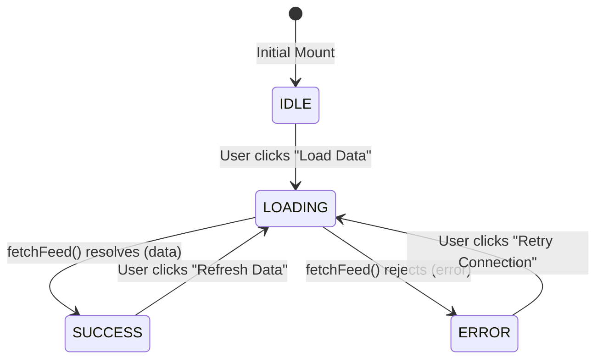
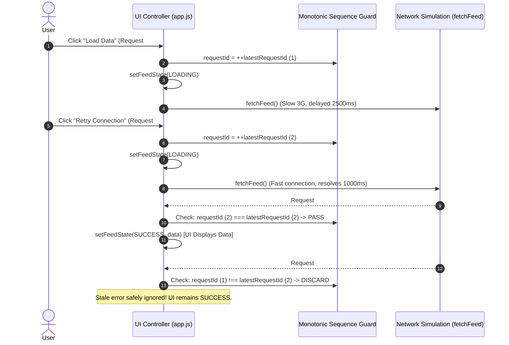

# PROJECT_STRUCTURE.md

## Exercise 3: Resilient State Machine & Skeleton Loader

**Course:** Web Application Development (Lab 02 — Exercise 3)  
**Deliverable:** Robust 4-state lifecycle handling (`IDLE`, `LOADING`, `SUCCESS`, `ERROR`), race-condition-free async data pipeline, pulsing CSS skeleton loader, human-readable error boundary with "Retry Connection" button, and unified Mini-React integration.  
**Core Technologies:** Pure Vanilla ES6+ JavaScript, Finite State Machine (FSM) Pattern, CSS3 Keyframe Animations, W3C Semantic HTML5 & WAI-ARIA Accessibility Standards.

---

## 1. Directory Structure

```text
24520225_NguyenBaoChinh_Lab02_EX3/
├── index.html              # HTML host mounting container (#app) with responsive styling & meta tags
├── mini_react.js           # Lightweight Virtual DOM engine: useState, createRoot, event delegation, focus preservation
├── state_machine.js        # Deterministic 4-state FSM: STATES, createInitialState, transition validator
├── app.js                  # Combined interactive application: Exercise 2 (Task Manager) & Exercise 3 (Resilient Feed)
├── styles.css              # Dark-mode design system, CSS keyframe skeleton pulse, responsive layout & error styles
├── test_runner.js          # Automated security & mounting assertion suite (XSS immunity, DOM integrity)
├── TASK_DECOMPOSITION.md   # In-class sprint timeline, Work Breakdown Structure (WBS), risk matrix & DoD checklist
├── AI_FAILURE_AUDIT.md     # In-depth engineering audit documenting 3 AI failure modes, diagnostics & clean fixes
└── PROJECT_STRUCTURE.md    # Architecture map, file responsibilities, data contracts, state machines & quality gates
```

---

## 2. File Responsibilities

| File | Responsibility | Key Exports / Elements | Design Constraints & Invariants |
|---|---|---|---|
| `state_machine.js` | Finite State Machine engine & state transition validator | `STATES`, `createInitialState()`, `transition()` | Pure function logic; frozen state constants; strict validation of state names & payload shapes (`Array.isArray(data)` on `SUCCESS`). |
| `app.js` | Unified application controller & UI component | `App()`, `fetchFeed()`, `loadFeedData()`, `renderExercise2()`, `renderExercise3()` | Monotonic request sequence token guard (`latestRequestId`) against race conditions; unconditional hook calls at top level; 4-state UI dispatch. |
| `styles.css` | Comprehensive styling system & skeleton loader animation | `@keyframes skeleton-pulse`, `.skeleton`, `.error-panel`, `.feed-card`, `.tab-nav` | Zero-CLS dimension matching between skeletons and cards; `@media (prefers-reduced-motion: reduce)` accessibility fallback. |
| `mini_react.js` | Custom Virtual DOM & reactive hook runtime | `createElement()`, `createTextElement()`, `useState()`, `createRoot()`, `renderApp()`, `renderToDOM()` | Zero external dependencies; safe text node creation (`document.createTextNode()`); root event delegation with zero orphan listeners; caret retention. |
| `index.html` | Browser host entrypoint | `<div id="app"></div>`, `<script type="module" src="./app.js">` | Clean semantic markup; viewport metadata configured for mobile responsiveness. |
| `test_runner.js` | Checkpoint 1 security & DOM mounting test suite | Security test suite assertions, `vApp` XSS verification | Verifies XSS immunity against `<script>` and `` vectors; verifies root rendering. |
| `TASK_DECOMPOSITION.md` | In-class sprint breakdown & execution blueprint | 7-phase WBS schedule, Checkpoint 3 protocol, risk matrix | Prescribes atomic Git commits, race condition mitigation, and Definition of Done. |
| `AI_FAILURE_AUDIT.md` | Audit report of AI-generated defects | 3 AI defects: XSS injection, caret desynchronization, async race condition | Documents root causes, DevTools reproduction steps, refactored clean code, and oral defense guide. |
| `PROJECT_STRUCTURE.md` | Architectural specification & reference manual | Architecture schemas, state transition matrices, sequence diagrams, verification gates | Single source of truth for technical design, data contracts, and quality verification. |

---

## 3. Architectural Specifications & Data Contracts

### 3.1 Finite State Machine (`state_machine.js`)

Component state is strictly modeled as a discriminated union conforming to the following formal contract:

```typescript
type ViewState<T> =
  | { status: 'IDLE' }
  | { status: 'LOADING' }
  | { status: 'SUCCESS'; data: T }
  | { status: 'ERROR'; error: string };
```

#### State Transition Matrix:

| Current State | Target State | Trigger / Action | Payload Required | Validator Rule (`transition()`) |
|:---:|:---:|:---|:---|:---|
| `IDLE` | `LOADING` | User clicks "Load Data" | None | Permitted unconditionally. |
| `LOADING` | `SUCCESS` | Network call resolves successfully | `{ data: Array<Item> }` | Asserts `Array.isArray(nextState.data)`. Throws if invalid. |
| `LOADING` | `ERROR` | Network drops / timeout / failure | `{ error: string }` | Normalizes error to string with fallback `"Unknown error"`. |
| `SUCCESS` | `LOADING` | User clicks "Refresh Data" | None | Permitted; resets view to skeleton loader. |
| `ERROR` | `LOADING` | User clicks "Retry Connection" | None | Permitted; resets view to skeleton loader. |
| *Any* | *Invalid* | Malformed payload or unlisted status | N/A | **Throws explicit Error:** `Invalid state: ${status}`. |



---

### 3.2 Asynchronous Data Pipeline & Race Condition Guard (`app.js`)

In asynchronous UI environments, multiple rapid network dispatches can settle out-of-order, leading to stale responses corrupting newer state. Exercise 3 enforces a **Monotonic Sequence Token Guard**:

```javascript
let latestRequestId = 0;

const loadFeedData = async () => {
  // 1. Monotonically increment local invocation token
  const requestId = ++latestRequestId;

  setFeedState({ status: STATES.LOADING });

  try {
    const items = await fetchFeed();

    // 2. Guard: If another request started while this was in-flight, discard stale result
    if (requestId !== latestRequestId) {
      return;
    }

    setFeedState(transition({ status: STATES.SUCCESS, data: items }));
  } catch (error) {
    // 3. Guard: Discard stale error responses
    if (requestId !== latestRequestId) {
      return;
    }

    setFeedState(transition({
      status: STATES.ERROR,
      error: error instanceof Error ? error.message : "An unexpected error occurred."
    }));
  }
};
```

#### Sequence Diagram of Race Condition Prevention:



---

### 3.3 Skeleton Loader & Perceptual Loading System (`styles.css`)

The skeleton loader is rendered during the `'LOADING'` state to provide visual continuity and avoid layout jump:

1. **Dimensional Parity:** `.skeleton-card` uses the exact same padding (20px), margin-bottom (14px), and border-radius (12px) as `.feed-card`.
2. **GPU-Accelerated Gradient Sweep:**
   ```css
   .skeleton {
       background: linear-gradient(90deg, #1e293b 25%, #334155 50%, #1e293b 75%);
       background-size: 200% 100%;
       animation: skeleton-pulse 1.4s ease-in-out infinite;
   }

   @keyframes skeleton-pulse {
       0% { background-position: 100% 0; }
       100% { background-position: -100% 0; }
   }
   ```
3. **Accessibility Integration:**
   - Wrapper elements are marked with `aria-busy="true"` and `aria-label="Loading data"`.
   - Reduced-motion media query deactivates continuous animations for vestibular sensitivity:
     ```css
     @media (prefers-reduced-motion: reduce) {
         .skeleton { animation: none; }
     }
     ```

---

### 3.4 Error Boundary & Self-Healing Resilience

When an asynchronous network request fails:
- State transitions to `{ status: 'ERROR', error: string }`.
- An isolated `.error-panel` is displayed with W3C `role="alert"` so assistive technologies announce the failure.
- The UI exposes an interactive "Retry Connection" button that directly re-invokes `loadFeedData()`, providing an immediate recovery path without page refresh.

---

### 3.5 Integration with Mini-React & Multi-Tab Layout

The application integrates both exercises into a unified, responsive interface:
- **Top-Level Hooks:** React hooks are called unconditionally in exact sequence:
  ```javascript
  const [activeTab, setActiveTab] = useState("ALL"); // "ALL" | "EX2" | "EX3"
  const [tasks, setTasks] = useState([...]);
  const [filter, setFilter] = useState("ALL");
  const [input, setInput] = useState("");
  const [feedState, setFeedState] = useState(createInitialState());
  ```
- **Tabbed Switching:** Switching between views ("Tất cả", "Exercise 2", "Exercise 3") alters DOM visibility without desynchronizing state indices or losing hook values in `stateStore`.

---

## 4. Mandatory Git Milestone Commits

| Commit Identifier | Type & Scope | Commit Message | Verified Deliverable |
|:---:|:---:|:---|:---|
| **Milestone 1** | `feat(ui)` | `feat(ui): implement multi-state data component with skeleton feedback` | 4-state lifecycle handling (`IDLE`, `LOADING`, `SUCCESS`, `ERROR`), animated CSS skeleton feedback, and retry connection mechanism. |
| **Documentation** | `docs(audit)` | `docs(audit): add mandatory AI failure mode audit report (AI_FAILURE_AUDIT.md)` | Comprehensive root cause analysis, diagnostic methods, and verified fixes for 3 AI failure modes. |
| **Documentation** | `docs(audit)` | `docs(audit): update AI_FAILURE_AUDIT.md formatting` | Enhanced markdown presentation, table formatting, and code references. |

---

## 5. Quality Gates & Verification Protocols

```bash
# 1. Verify file presence and zero lint errors
ls -la state_machine.js app.js styles.css mini_react.js index.html

# 2. Run automated security and mounting test suite in browser console
# Open index.html via local server (e.g. npx serve . or python3 -m http.server)
# Verify console asserts pass:
# "✅ Checkpoint 1 & Security tests passed successfully!"

# 3. Verify Finite State Machine transitions in DevTools Console:
# - Transition to LOADING: state.status === "LOADING"
# - Transition to SUCCESS: Array.isArray(state.data) === true
# - Transition to ERROR: typeof state.error === "string"
# - Invalid transition: transition({ status: "FOO" }) throws Error

# 4. Verify race condition immunity:
# - Set Chrome DevTools Network to "Slow 3G"
# - Trigger "Retry Connection" repeatedly in rapid succession (< 500ms intervals)
# - Confirm no stale responses overwrite the UI
```
