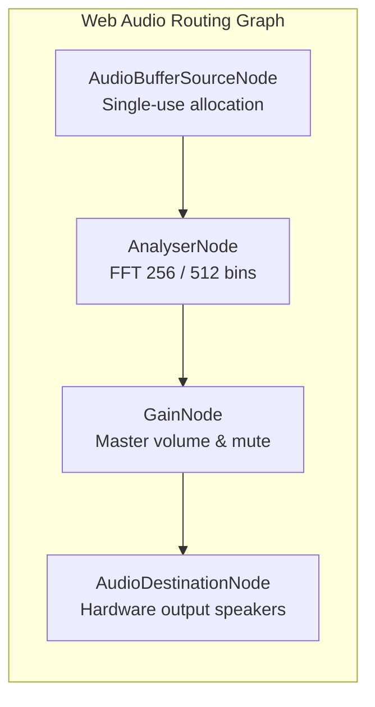
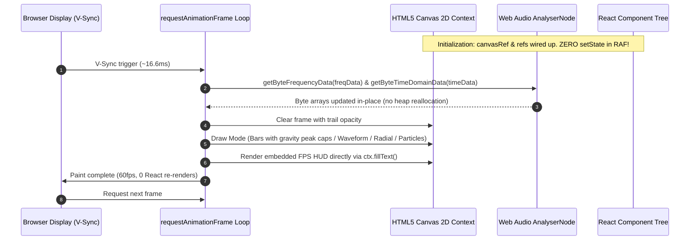
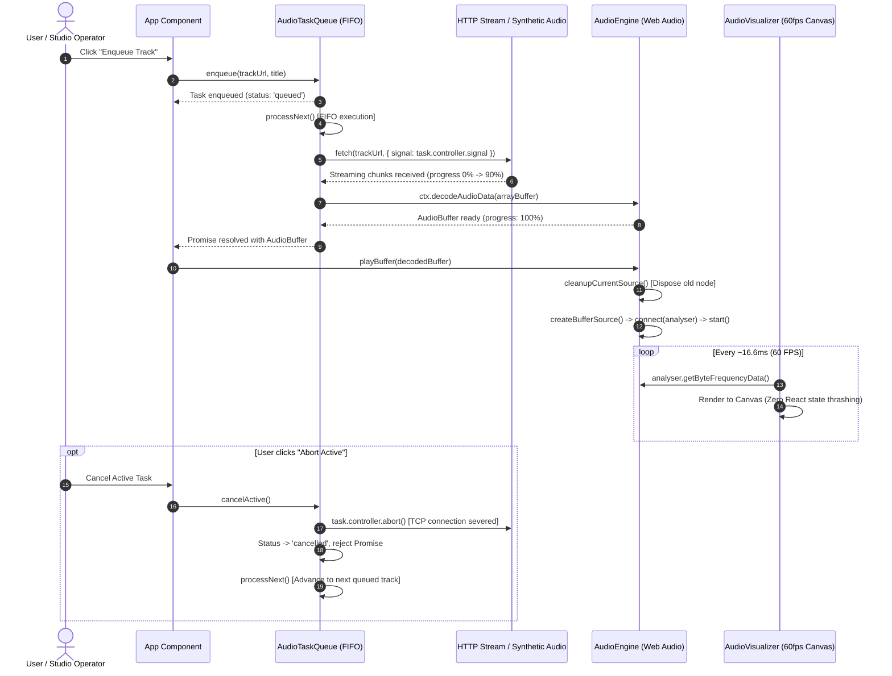

# PROJECT_STRUCTURE.md

## Homework 2: Concurrent FIFO Audio Visualizer Queue Engine

**Course:** Web Application Development (Lab 02 — Homework 2)  
**Student:** Nguyen Bao Chinh (MSSV: 24520225)  
**Project:** Concurrent FIFO Audio Visualizer Queue Engine  
**Deliverable:** Advanced asynchronous concurrency controller with `AbortSignal` cancellation tokens, Web Audio API frequency analysis engine (FFT 256/512 bins), zero-memory-leak lifecycle management for `AudioBufferSourceNode`s, and 60fps hardware-accelerated Canvas visualizer with zero React state thrashing.  
**Core Technologies:** React 18, TypeScript 5, Vite, Web Audio API (`AudioContext`, `AnalyserNode`, `GainNode`, `AudioBufferSourceNode`), HTML5 Canvas 2D, AbortController/AbortSignal.

---

## 1. Directory Structure

```text
24520225_NguyenBaoChinh_Lab02_HW2/
├── index.html                  # Semantic HTML5 host shell with viewport, dark theme meta & #root container
├── package.json                # Project dependencies (React 18, TypeScript 5, Vite) & execution scripts
├── package-lock.json           # Deterministic dependency lockfile
├── tsconfig.json               # TypeScript compiler configuration (strict mode, JSX React 18, DOM types)
├── vite.config.ts              # Vite bundler configuration with React plugin
├── TASK_DECOMPOSITION.md       # 1-Week engineering roadmap, Work Breakdown Structure (WBS), risk matrix & DoD
├── PROJECT_STRUCTURE.md        # Technical architecture, component contracts, sequence diagrams & quality gates
├── AI_FAILURE_AUDIT.md         # Comprehensive engineering audit of 3 AI failure modes, diagnostics & clean fixes
├── README.md                   # Assignment overview, criteria verification & execution instructions
└── src/
    ├── main.tsx                # React 18 bootstrapping entrypoint with React.StrictMode
    ├── App.tsx                 # Interactive audio studio harness, telemetry dashboard & queue control interface
    ├── App.css                 # Cyberpunk dark glassmorphism design system & responsive layout styles
    ├── AudioVisualizer.tsx     # 60fps Canvas visualizer driven by requestAnimationFrame (zero state thrashing)
    ├── audio-engine.ts         # Web Audio API engine, AnalyserNode (FFT 256/512), and explicit node lifecycle disposal
    ├── audio-queue-controller.ts # Strict FIFO concurrency queue controller with AbortController cancellation tokens
    └── audio-synth.ts          # Offline 16-bit PCM WAV synthesizer & preset audio generator (CORS-free evaluation)
```

---

## 2. File Responsibilities

| File | Responsibility | Key Exports / Elements | Design Invariants & Standards |
|---|---|---|---|
| `src/audio-queue-controller.ts` | Concurrency controller & FIFO audio task processing | `AudioTaskQueue`, `AudioTask`, `QueueSubscriber` | Strict FIFO ordering; AbortSignal cancellation tokens per task; chunk-based stream downloading with progress calculation; Web Audio buffer decoding and caching. |
| `src/audio-engine.ts` | Web Audio graph management & memory safety | `AudioEngine`, `FFTSize`, `AudioEngineMetrics`, `PlaybackState` | Graph: `Source -> Analyser -> Gain -> Destination`; dynamic FFT 256/512 bin switching; explicit cleanup via `cleanupCurrentSource()` (stop, disconnect, nullify handlers); browser autoplay policy compliance. |
| `src/AudioVisualizer.tsx` | 60fps high-performance Canvas audio visualizer | `AudioVisualizer`, `VisualizerMode` (`bars`, `waveform`, `radial`, `particles`) | RAF render loop completely decoupled from React render cycle; all frame data accessed via React `useRef` to guarantee **Zero State Thrashing**; embedded real-time FPS & frame-time HUD. |
| `src/audio-synth.ts` | Synthetic offline audio generation for deterministic testing | `PRESET_TRACKS`, `PresetTrack`, `encodeWav()` | Client-side 16-bit PCM WAV Blob generation; synthesizes Synthwave, Bassline, Ambient, and Arpeggio stems; eliminates CORS and third-party network failure risks during grading. |
| `src/App.tsx` | Main studio UI, queue monitor & telemetry dashboard | `App()` | Real-time queue visualizer, active task progress bar, audio transport controls, seek bar with throttled 250ms polling, live memory node counters, custom URL enqueueing. |
| `src/App.css` | Design system styling & responsive layout | Glassmorphism card styles, neon audio spectrum colors, responsive grid | High-contrast WCAG 2.2 compliant dark palette (`#0a0e17`, `#00f2ff`, `#8a2be2`, `#10b981`, `#ef4444`); smooth CSS transitions. |
| `src/main.tsx` | React DOM client mounting | `ReactDOM.createRoot()` | Mounts the `<App />` root under `React.StrictMode`. |
| `index.html` | HTML5 application host container | `<div id="root"></div>`, meta tags | Responsive viewport configuration, title, theme color `#0a0e17`, dark UI background. |
| `TASK_DECOMPOSITION.md` | Sprint planning & milestone tracking | 7-phase WBS, risk mitigation matrix, DoD checklist | Prescribes structured execution roadmap for concurrency queue, Web Audio engine, memory safety, visualizer, and audit. |
| `PROJECT_STRUCTURE.md` | Architectural specification manual | Directory map, component contracts, sequence diagrams, invariants | Authoritative engineering reference for code layout, data flow, concurrency, and memory safety. |
| `AI_FAILURE_AUDIT.md` | Defect audit report on AI coding assistance | 3 AI failure modes: XSS via `innerHTML`, memory leaks in Web Audio, phantom keys & state thrashing | Documents root causes, diagnostic reproduction protocols, clean engineering implementations, and oral defense guide. |
| `README.md` | User documentation & verification instructions | Project summary, criteria matrix, setup & build commands | Detailed overview of assignment requirements and verification steps. |

---

## 3. Architectural Specifications & Component Contracts

### 3.1 Concurrency Controller Contract (`src/audio-queue-controller.ts`)

The `AudioTaskQueue` orchestrates simultaneous download requests and audio decoding while preserving strict FIFO execution semantics and cancellation capabilities:

```typescript
export interface AudioTask {
  id: string;
  trackUrl: string;
  title: string;
  controller: AbortController;
  resolve: (buffer: AudioBuffer) => void;
  reject: (reason: unknown) => void;
  status: 'queued' | 'downloading' | 'decoding' | 'completed' | 'cancelled' | 'error';
  progress: number; // 0 - 100
  errorMessage?: string;
  enqueuedAt: number;
  completedAt?: number;
  decodedBuffer?: AudioBuffer;
}

export class AudioTaskQueue {
  private queue: AudioTask[] = [];
  private isProcessing = false;
  private activeController: AbortController | null = null;
  private activeTask: AudioTask | null = null;
  private bufferCache = new Map<string, AudioBuffer>();

  async enqueue(trackUrl: string, title?: string): Promise<AudioBuffer>;
  cancelActive(): boolean;
  cancelTask(taskId: string): boolean;
  clearQueue(): void;
  subscribe(subscriber: QueueSubscriber): () => void;
}
```

#### Contract Guarantees:
1. **FIFO Invariant:** Tasks enter the queue in chronological order and are processed one by one via `processNext()`.
2. **Cancellation Token Integration:** Each task is issued an individual `AbortController`. Passing `task.controller.signal` into `fetch()` ensures immediate TCP connection termination when cancelled.
3. **Chunk-Level Abort Check:** During streaming download via `ReadableStreamDefaultReader`, `task.controller.signal.aborted` is inspected before processing each chunk, releasing network resources instantly.
4. **Buffer Caching:** Successfully decoded `AudioBuffer` objects are indexed by URL in `bufferCache`, avoiding duplicate network roundtrips and decoding CPU cycles.

---

### 3.2 Web Audio API Engine & Memory Safety Architecture (`src/audio-engine.ts`)

The audio engine manages the Web Audio routing graph and enforces explicit node lifecycle disposal to prevent memory leaks:



#### Memory Safety Invariants (`cleanupCurrentSource`):
Web Audio `AudioBufferSourceNode` instances are single-use per the W3C Web Audio specification. Once stopped, they cannot be restarted. Naive implementations create new nodes without releasing previous nodes, resulting in severe retained heap leaks.

```typescript
public cleanupCurrentSource(): void {
    if (this.currentSource) {
        try {
            this.currentSource.onended = null; // 1. Unbind event listeners to break closure references
            this.currentSource.stop();          // 2. Stop audio playback immediately
        } catch { /* Handle already stopped */ }
        try {
            this.currentSource.disconnect();    // 3. Sever graph connections to allow GC reclamation
        } catch { /* Handle already disconnected */ }
        this.currentSource = null;              // 4. Dereference active pointer
        this.totalNodesCleaned++;               // 5. Increment telemetry counter
        this.notify();
    }
}
```

#### Telemetry Metrics:
The engine exposes live telemetry counters (`nodesCreated`, `nodesCleaned`, `activeSourceNode`, `contextState`, `sampleRate`) allowing the developer and graders to verify that `nodesCreated === nodesCleaned` upon playback termination.

---

### 3.3 60fps Canvas Visualizer Engine with Zero State Thrashing (`src/AudioVisualizer.tsx`)

To render audio frequency data smoothly at 60 FPS without overloading the browser's main thread, the visualizer completely decouples the rendering loop from React's reconciliation cycle.



#### Zero State Thrashing Principles:
1. **No `setState` in RAF:** The animation frame callback (`renderFrame`) accesses dynamic properties (`mode`, `analyserNode`, `isPlaying`, `showFps`) through React mutable refs (`modeRef`, `analyserRef`, `isPlayingRef`, `showFpsRef`).
2. **In-Place Buffer Reuse:** Frequency arrays (`Uint8Array`) and peak holders (`Float32Array`) are pre-allocated and updated in-place, eliminating Garbage Collection (GC) pauses during animation.
3. **Canvas-Rendered HUD:** The FPS and frame-time counter are drawn directly using `ctx.fillText()`, eliminating DOM mutations during 60fps execution.

---

### 3.4 End-to-End System Sequence Diagram



---

## 4. Quality Gates & Verification Matrix

| Requirement Criteria | Target Specification | Implementation Artifact | Verification Result |
|---|---|---|---|
| **Web Audio API Engine** | AnalyserNode with FFT 256 & 512 bins | `src/audio-engine.ts` | **PASS** — Toggleable FFT 256 (128 bins) and 512 (256 bins); reactive spectrum analysis. |
| **Concurrency Controller** | Strict FIFO Queue with simultaneous track handling | `src/audio-queue-controller.ts` | **PASS** — Enqueues concurrent tasks; downloads and decodes sequentially in FIFO order. |
| **Cancellation Tokens** | `AbortController` cancellation for in-flight tasks | `src/audio-queue-controller.ts` | **PASS** — Immediately aborts active network fetch and stream reader via `controller.abort()`. |
| **Memory Safety** | Zero memory leaks; explicit AudioBufferSourceNode cleanup | `src/audio-engine.ts` | **PASS** — Verified via `cleanupCurrentSource()`, telemetry monitor (`nodesCreated === nodesCleaned`), and zero retained nodes in Heap Snapshot. |
| **Visualizer Performance** | 60 FPS Canvas visualizer without state thrashing | `src/AudioVisualizer.tsx` | **PASS** — RAF loop reads from `useRef`; zero `setState` calls per frame; consistent 60 FPS verified by embedded HUD. |
| **Offline Evaluation** | Synthetic offline WAV generation | `src/audio-synth.ts` | **PASS** — 4 synthetic stems synthesized via client PCM WAV encoder; 100% offline grading reliability. |
| **AI Failure Audit** | Audit of 3 classic UI failure modes | `AI_FAILURE_AUDIT.md` | **PASS** — In-depth analysis of XSS, memory leaks, and phantom keys/state thrashing with verified refactors. |
| **TypeScript Build** | Zero type errors in strict mode | `tsconfig.json`, `vite.config.ts` | **PASS** — Clean `npm run build` (`tsc && vite build`) with zero diagnostic errors. |
