# PROJECT_STRUCTURE.md

## Homework 3: High-Concurrency Flash-Sale E-Commerce Engine

**Course:** Web Application Development (Lab 02 — Homework 3)  
**Student:** Nguyen Bao Chinh (MSSV: 24520225)  
**Project:** High-Concurrency Flash-Sale E-Commerce Engine  
**Deliverable:** High-precision Zero-Drift Countdown Timer using `requestAnimationFrame` and `Date.now()` delta, Optimistic Inventory Lock Finite State Machine (`InventoryLockFSM`), high-throughput Concurrency Engine & Bot Flood Simulator (`ConcurrencyEngine`), live empirical telemetry benchmark comparing RAF timer vs drift-prone `setInterval` with CPU throttling simulator, Vietnam 11.11 Mega-Sale storefront interface with checkout flow, automated invariant verification suite (`telemetry-verifier.ts`), and comprehensive AI Failure Mode Audit (`AI_FAILURE_AUDIT.md`).  
**Core Technologies:** React 18, TypeScript 5, Vite, `requestAnimationFrame`, Finite State Machine (FSM), Optimistic Concurrency Control (OCC), CSS3 Glassmorphism Design System.

---

## 1. Directory Structure

```text
24520225_NguyenBaoChinh_Lab02_HW3/
├── index.html                     # Semantic HTML5 host shell with responsive viewport & #root container
├── package.json                   # Project dependencies (React 18, TypeScript 5, Vite) & execution scripts
├── package-lock.json              # Deterministic dependency lockfile
├── tsconfig.json                  # TypeScript compiler configuration (strict mode, JSX React 18, DOM types)
├── vite.config.ts                 # Vite bundler configuration with React plugin
├── TASK_DECOMPOSITION.md          # 1-Week engineering roadmap, Work Breakdown Structure (WBS), risk matrix & DoD
├── PROJECT_STRUCTURE.md           # Technical architecture, component contracts, state transitions & quality gates
├── AI_FAILURE_AUDIT.md            # Comprehensive engineering audit of 3 AI failure modes, diagnostics & clean fixes
├── README.md                      # Assignment overview, criteria verification & execution instructions
└── src/
    ├── main.tsx                   # React 18 client entrypoint mounted with React.StrictMode
    ├── App.tsx                    # Vietnam 11.11 flash-sale storefront, telemetry benchmark HUD & bot simulator
    ├── App.css                    # Responsive dark glassmorphism styling, Shopee/Lazada theme & neon status cues
    ├── anti-drift-timer.ts        # Zero-drift timer (requestAnimationFrame), setInterval comparison & CPU blocker
    ├── inventory-state-machine.ts # Optimistic Inventory Lock FSM (7 states, 30s auto-expiry, stock conservation)
    ├── concurrency-engine.ts      # Multi-product FSM coordinator, OCC versioning, bot flood simulator & ring logger
    ├── telemetry-verifier.ts      # Automated concurrency invariant test suite & empirical timer drift benchmarker
    ├── products-data.ts           # Realistic Vietnam flash-sale product catalog (iPhone 16 Pro Max, Sony ANC, etc.)
    └── types.ts                   # Strict TypeScript domain interfaces for locks, orders, logs, and telemetry
```

---

## 2. File Responsibilities

| File | Responsibility | Key Exports / Elements | Design Invariants & Standards |
|---|---|---|---|
| `src/anti-drift-timer.ts` | High-precision countdown timer engine & benchmark | `createAntiDriftTimer`, `createDriftProneIntervalTimer`, `formatCountdown`, `blockMainThreadSync` | Zero-drift invariant via `Math.max(0, targetTime - Date.now())` on every animation frame; returns explicit unmount callback; zero innerHTML; CPU throttling demonstration. |
| `src/inventory-state-machine.ts` | Finite State Machine for optimistic inventory reservation | `InventoryLockFSM`, `FSMEvent`, `FSMTransitionResult` | 7 discrete states (`AVAILABLE`, `RESERVED`, `CHECKING_OUT`, `PURCHASED`, `LOCK_EXPIRED`, `CANCELLED`, `OUT_OF_STOCK`); 30s auto-expiry; strict stock conservation invariant; zero overselling. |
| `src/concurrency-engine.ts` | Concurrency coordinator & bot flood attack simulator | `ConcurrencyEngine` | Manages per-product FSMs; executes hyper-concurrent bot simulations (up to 100 bots); ring-buffer logging capped at 250 items; HTTP-like status codes (200, 409, 410, 408). |
| `src/telemetry-verifier.ts` | Automated testing & telemetry verification suite | `runConcurrencyInvariantTest`, `benchmarkTimerDrift`, `VerificationReport` | Executes on application mount; dispatches 100 concurrent workers against 5 stock units; verifies mathematical invariants; logs styled proof matrices to Chrome DevTools console. |
| `src/products-data.ts` | Realistic Vietnam e-commerce product catalog & vouchers | `FLASH_SALE_PRODUCTS`, `PROMOTIONAL_VOUCHERS` | 6 authentic Vietnam mega-sale deals (iPhone 16 Pro Max, Sony WH-1000XM5, NuPhy Air75, Lock&Lock, Biti's Hunter, Dyson); VND pricing; flash discount tags; promotional codes. |
| `src/types.ts` | Domain data models & type definitions | `LockState`, `ProductInventory`, `InventoryLockLease`, `OrderRecord`, `ConcurrencyLogEntry`, `ConcurrencyMetrics` | Strict compile-time type safety; explicit user types (`HUMAN` vs `BOT`); status codes and invariant tracking fields. |
| `src/App.tsx` | Main storefront harness, telemetry HUD & checkout UI | `App()` | Vietnam 11.11 header, live countdown timer, live drift telemetry comparison, stock meters, checkout modal (MoMo/VNPay/ShopeePay/COD), bot flood trigger, and live terminal console. |
| `src/App.css` | Design system styling & responsive layout | Glassmorphism card styles, neon badges, responsive grid | High-contrast WCAG 2.2 compliant dark palette (`#0f172a`, `#ee4d2d`, `#facc15`, `#10b981`, `#ef4444`); smooth transitions and responsive mobile breakpoints. |
| `src/main.tsx` | React 18 client bootstrapping | `ReactDOM.createRoot()` | Mounts the `<App />` root under `React.StrictMode`. |
| `index.html` | HTML5 application host container | `<div id="root"></div>`, meta tags | Responsive viewport configuration, title, theme color `#0f172a`, dark UI background. |
| `TASK_DECOMPOSITION.md` | Sprint planning & milestone tracking | 7-phase WBS, risk mitigation matrix, DoD checklist | Prescribes structured execution roadmap for zero-drift timer, inventory FSM, concurrency bot simulator, and audit. |
| `PROJECT_STRUCTURE.md` | Architectural specification manual | Directory map, component contracts, state transitions, sequence flow | Authoritative engineering reference for code layout, data flow, concurrency, and memory safety. |
| `AI_FAILURE_AUDIT.md` | Defect audit report on AI coding assistance | 3 AI failure modes: XSS via `innerHTML`, zombie timers/memory leaks, phantom keys & DOM thrashing | Documents root causes, diagnostic reproduction protocols, clean engineering implementations, and oral defense guide. |
| `README.md` | User documentation & verification instructions | Project summary, criteria matrix, setup & build commands | Detailed overview of assignment requirements and verification steps. |

---

## 3. Architectural Specifications & Component Contracts

### 3.1 Zero-Drift Countdown Timer Contract (`src/anti-drift-timer.ts`)

The `createAntiDriftTimer` decouples timer progression from browser task queue delays by continuously calculating the delta between absolute wall-clock target time and the current timestamp:

```typescript
export function createAntiDriftTimer(
  durationMs: number,
  onTick: (remaining: number) => void
): () => void;

export function createDriftProneIntervalTimer(
  durationMs: number,
  onTick: (reportedRemaining: number, actualRemaining: number, driftMs: number) => void,
  intervalMs?: number
): () => void;

export function formatCountdown(ms: number): {
  hours: string;
  minutes: string;
  seconds: string;
  milliseconds: string;
  totalFormatted: string;
  shortFormatted: string;
};

export function blockMainThreadSync(blockMs?: number): number;
```

#### Contract Guarantees:
1. **Zero Cumulative Drift Invariant:**
   $$\text{remaining} = \max(0, \text{targetTime} - \text{Date.now}())$$
   Because `targetTime` is fixed at initialization, delays in executing `tick()` do not accumulate. On the next available frame, the timer instantly snaps back to the true wall-clock time.
2. **Explicit Unmount Lifecycle:** Calling the returned closure sets an internal cancellation flag and triggers `cancelAnimationFrame(rafId)`, guaranteeing zero orphaned loops or memory leaks.
3. **Empirical Side-by-Side Proof:** `createDriftProneIntervalTimer()` accumulates delay due to macrotask scheduling and garbage collection pauses, which is exposed to the UI and verified via `blockMainThreadSync()`.

---

### 3.2 Optimistic Inventory Lock Finite State Machine Contract (`src/inventory-state-machine.ts`)

The `InventoryLockFSM` manages atomic state transitions for each product, enforcing strict stock conservation and auto-expiring 30-second leases:

```typescript
export type FSMEvent =
  | { type: 'ACQUIRE_LOCK'; userId: string; userName: string; userType: 'HUMAN' | 'BOT'; leaseDurationMs: number }
  | { type: 'START_CHECKOUT'; lockId: string }
  | { type: 'COMPLETE_PURCHASE'; lockId: string }
  | { type: 'EXPIRE_LOCK'; lockId: string }
  | { type: 'RELEASE_LOCK'; lockId: string };

export interface FSMTransitionResult {
  success: boolean;
  previousState: LockState;
  nextState: LockState;
  lease?: InventoryLockLease;
  error?: string;
  statusCode: 200 | 409 | 410 | 408 | 404;
}

export class InventoryLockFSM {
  constructor(product: ProductInventory);
  public getProduct(): ProductInventory;
  public getActiveLeases(): InventoryLockLease[];
  public subscribe(listener: (product: ProductInventory, leases: InventoryLockLease[]) => void): () => void;
  public transition(event: FSMEvent): FSMTransitionResult;
  public destroy(): void;
}
```

---

## 4. State Machine Specification & Invariant Equations

### 4.1 State Transition Matrix

```text
+---------------------------------------------------------------------------------------------------------+
|                                OPTIMISTIC INVENTORY LOCK FSM TRANSITIONS                                |
+------------------+-------------------+--------------------+------------------+--------------------------+
| Current State    | Event             | Guard Condition    | Next State       | HTTP Status Code         |
+------------------+-------------------+--------------------+------------------+--------------------------+
| AVAILABLE        | ACQUIRE_LOCK      | availableStock > 0 | RESERVED         | 200 OK                   |
| AVAILABLE        | ACQUIRE_LOCK      | availableStock = 0 | OUT_OF_STOCK     | 410 Gone                 |
| RESERVED         | START_CHECKOUT    | now <= expiresAt   | CHECKING_OUT     | 200 OK                   |
| RESERVED         | START_CHECKOUT    | now > expiresAt    | LOCK_EXPIRED     | 408 Request Timeout      |
| RESERVED         | EXPIRE_LOCK       | 30s elapsed        | LOCK_EXPIRED     | 408 Request Timeout      |
| RESERVED         | RELEASE_LOCK      | user cancels       | CANCELLED        | 200 OK                   |
| CHECKING_OUT     | COMPLETE_PURCHASE | now <= expiresAt   | PURCHASED        | 200 OK                   |
| CHECKING_OUT     | COMPLETE_PURCHASE | now > expiresAt    | LOCK_EXPIRED     | 408 Request Timeout      |
| CHECKING_OUT     | EXPIRE_LOCK       | 30s elapsed        | LOCK_EXPIRED     | 408 Request Timeout      |
| CHECKING_OUT     | RELEASE_LOCK      | user cancels       | CANCELLED        | 200 OK                   |
+------------------+-------------------+--------------------+------------------+--------------------------+
```

### 4.2 Mathematical Invariants

1. **Stock Conservation Law:**  
   At any point in time $t$, across all state transitions:
   $$\text{totalStock} = \text{availableStock}(t) + \text{reservedStock}(t) + \text{soldStock}(t)$$

2. **Strict Zero-Oversell Bound:**
   $$\text{availableStock}(t) \ge 0, \quad \text{reservedStock}(t) \ge 0, \quad \text{soldStock}(t) \le \text{totalStock}$$

3. **Optimistic Version Progression:**  
   Every atomic modification increments the version vector:
   $$\text{version}_{k+1} = \text{version}_k + 1$$

---

## 5. End-to-End Data Flow & Sequence Diagram

The following sequence illustrates how a client or simulated bot interacts with the concurrency engine and state machine during a flash-sale reservation attempt:

```mermaid
sequenceDiagram
    autonumber
    actor Client as Customer / Bot Worker
    participant Engine as ConcurrencyEngine
    participant FSM as InventoryLockFSM
    participant Timer as Auto-Expiry Lease Timer
    participant Store as React App State

    Client->>Engine: requestReservation(productId, userId, 'HUMAN', 30000)
    Engine->>FSM: transition({ type: 'ACQUIRE_LOCK', ... })
    
    alt Stock Exhausted (availableStock <= 0)
        FSM-->>Engine: FSMTransitionResult (success: false, statusCode: 410 Gone)
        Engine-->>Client: 410 Gone ("Flash sale allocation exhausted")
    else Stock Available (availableStock > 0)
        FSM->>FSM: availableStock--, reservedStock++, version++
        FSM->>Timer: setTimeout(EXPIRE_LOCK, 30000ms)
        FSM-->>Engine: FSMTransitionResult (success: true, statusCode: 200 OK, lease)
        Engine->>Engine: appendLog(200 OK), updateMetrics()
        Engine-->>Client: 200 OK (InventoryLockLease issued)
        Engine->>Store: notifySubscribers(updatedProduct, leases)
    end

    opt Customer Completes Checkout
        Client->>Engine: completePurchase(productId, lockId, 'MOMO')
        Engine->>FSM: transition({ type: 'COMPLETE_PURCHASE', lockId })
        FSM->>Timer: clearTimeout(lockId)
        FSM->>FSM: reservedStock--, soldStock++, version++
        FSM-->>Engine: 200 OK (State: PURCHASED)
        Engine->>Engine: recordOrder(OrderRecord)
        Engine->>Store: notifySubscribers()
        Engine-->>Client: Order Confirmation
    end

    opt Lease Expires (Customer Abandons)
        Timer->>FSM: transition({ type: 'EXPIRE_LOCK', lockId })
        FSM->>FSM: reservedStock--, availableStock++, version++
        FSM-->>Engine: 408 Request Timeout (State: LOCK_EXPIRED)
        Engine->>Store: notifySubscribers()
    end
```



---

## 6. Concurrency Architecture & Bot Flood Simulation

### 6.1 Optimistic Concurrency Control (OCC) Pipeline
* When multiple workers attempt to lock the same limited item simultaneously, requests are processed deterministically against the current FSM state.
* If stock is depleted, subsequent requests immediately receive `410 Gone` or `409 Conflict`.
* No threads are blocked; atomicity is guaranteed within JavaScript's single-threaded event loop execution turn while supporting asynchronous arrival patterns.

### 6.2 Bot Flood Attack Simulator (`simulateBotFlood`)
* Supports dispatching 10, 25, 50, or 100 concurrent asynchronous bot workers attacking a target product within an artificial arrival window (e.g., 50–150ms).
* Each worker simulates human-like network jitter (0–20ms) before issuing `requestReservation`.
* Automatically measures peak RPS and live conflict resolution:
  - Total Bot Requests: $N$
  - Successful 200 OK Locks: $\min(N, \text{availableStock})$
  - Rejected 409/410 Requests: $\max(0, N - \text{availableStock})$
  - Oversell Violations: Strictly 0

---

## 7. Quality Gates & Verification Protocol

### 7.1 Automated Invariant Verification (`src/telemetry-verifier.ts`)
* **Execution:** Triggered automatically upon application mount in `React.useEffect`.
* **Assertion 1:** Dispatches 100 concurrent workers against 5 stock units. Verifies that exactly 5 succeed and 95 are rejected.
* **Assertion 2:** Asserts `availableStock + reservedStock + soldStock === totalStock`.
* **Assertion 3:** Asserts `oversellViolations === 0`.
* **Console Output:** Formatted in Chrome DevTools using styled `console.group()` for audit verification.

### 7.2 Memory Safety & Lifecycle Disposal
* All timer loops initiated by `createAntiDriftTimer` return an unmount cancellation callback invoking `cancelAnimationFrame`.
* `InventoryLockFSM.destroy()` explicitly iterates through `lockTimers` and cancels all pending `window.clearTimeout` handles.
* Ring-buffer log in `ConcurrencyEngine` is strictly clamped to 250 items to prevent unbounded memory growth during continuous stress testing.

### 7.3 Security Standard (Zero `innerHTML`)
* All dynamic product labels, discount strings, and user identifiers are rendered strictly through typed React JSX virtual DOM text nodes.
* Zero occurrences of `element.innerHTML`, `element.outerHTML`, or `dangerouslySetInnerHTML` in the entire codebase.
