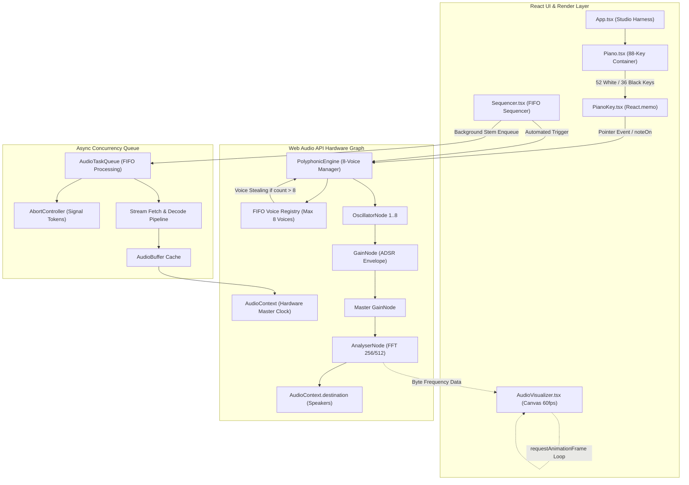
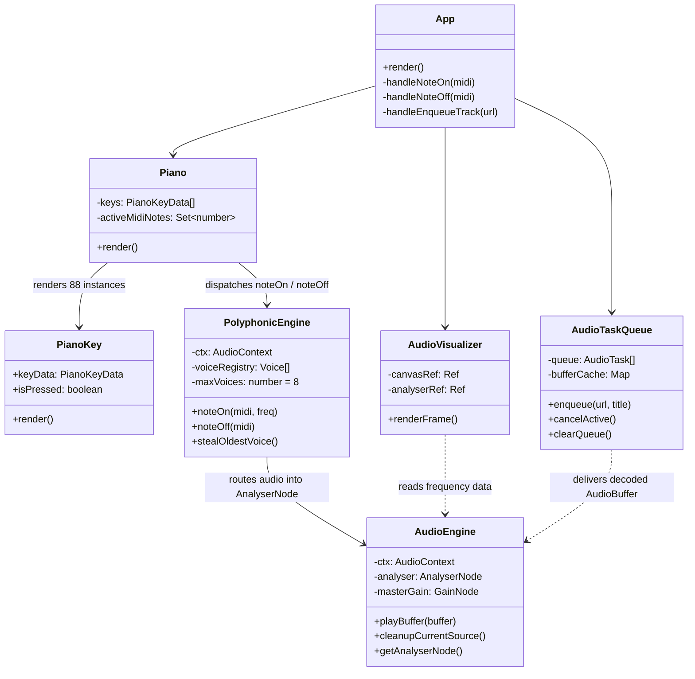

# PROJECT_STRUCTURE.md – 88-Key Polyphonic Piano & Concurrent FIFO Sequencer

**Course:** Web Application Development (Lab 03 — Homework 2)  
**Student:** Nguyen Bao Chinh (MSSV: 24520225)  
**Project:** 88-Key Polyphonic Piano Studio & Concurrent FIFO Audio Sequencer  
**Repository Branch:** `main`  
**Current Baseline Commit:** `bd9440d` (`chore(hw2): initialize piano studio project`)

---

## 1. Project Overview

The **88-Key Polyphonic Piano Studio & Concurrent FIFO Sequencer** is an advanced interactive Web Audio synthesis and visualizer workstation built with React, TypeScript, and Vite. The system synthesizes four foundational concepts from Web Application Development:

1. **Algorithmic 88-Key Generation (Legacy Slide 27):** Complete mathematical generation of all 88 acoustic piano keys from MIDI note A0 (`21`) to C8 (`108`), comprising exactly 52 white keys and 36 black keys. Frequencies are dynamically computed using standard equal temperament:
   $$f = 440 \times 2^{\frac{\text{midi} - 69}{12}}$$
2. **React.memo Render Isolation (Lab 2 Slide 21):** High-frequency render isolation where each piano key is wrapped in `React.memo` with isolated pressed state and stable callbacks. Pressing or releasing a key re-renders **only that single key component**, preventing catastrophic 88-element re-render cascades.
3. **8-Voice Polyphony with Strict FIFO Voice Stealing:** Synthesizer architecture supporting up to 8 concurrent Web Audio `OscillatorNode` voices. When a 9th concurrent note is triggered, the synthesizer automatically identifies and steals the oldest active voice in First-In, First-Out (FIFO) order, applying smooth gain de-clicking before allocating the new voice.
4. **Concurrent FIFO AudioTaskQueue & Hardware Visualizer (Lab 2 HW2):** Integration of an asynchronous audio queue featuring `AbortController` cancellation tokens, explicit memory safety lifecycle management for `AudioBufferSourceNode`s, and a 60 FPS Canvas spectrum visualizer driven by `requestAnimationFrame` with zero React state thrashing.
5. **Architectural Principles from Lab 2 EX2:** Leveraging clean unidirectional data flow, root event delegation for pointer interactions, and ref-stabilized dispatch to avoid orphaned event listeners and stale closures.

---

## 2. Technology Stack & Runtime Environment

The table below documents the **actual versions** installed and resolved in the project repository (`package.json` and `package-lock.json`):

| Technology / Package | Specification in `package.json` | Installed / Resolved Version | Classification | Purpose in Project |
|---|---|---|---|---|
| **React** | `^18.3.1` | `18.3.1` | Production Dependency | Core component framework, Virtual DOM reconciliation, `React.memo` render isolation, concurrent hook dispatching |
| **React DOM** | `^18.3.1` | `18.3.1` | Production Dependency | DOM renderer for mounting the React tree into the browser host element (`#root`) |
| **TypeScript** | `^5.6.3` | `5.6.3` | Dev Dependency | Strict static typing, interface contracts (`PianoKeyData`, `AudioTask`, `AudioEngineMetrics`), generic state modeling |
| **Vite** | `^5.4.10` | `5.4.21` (resolved in lockfile) | Dev Dependency | Next-generation ESM dev server (HMR < 50ms) and Rollup-based production bundler |
| **@vitejs/plugin-react** | `^4.3.3` | `4.3.3` | Dev Dependency | Vite plugin providing Fast Refresh and Babel/SWC JSX transformation |
| **Web Audio API** | Native W3C Standard | Browser Native (`AudioContext`) | Hardware API | Native hardware-timed audio graph (`AudioContext`, `OscillatorNode`, `GainNode`, `AnalyserNode`, `AudioBufferSourceNode`) |
| **HTML5 Canvas 2D** | Native W3C Standard | Browser Native (`CanvasRenderingContext2D`) | Graphics API | 60 FPS frequency spectrum visualizer rendered in hardware without React DOM overhead |
| **Vitest** | *Not Installed* | *Planned (M7)* | Testing Framework | Scheduled for addition in Milestone M7 for automated algorithmic key and frequency unit testing |

*Note on React Versioning:* The project currently executes on **React 18.3.1** (with `React.StrictMode` enabled in `src/main.tsx`). Architecture and hooks are designed to be forward-compatible with **React 19** compiler optimizations and automatic memoization.

---

## 3. Directory Tree & Implementation Status

The file structure below explicitly distinguishes between **currently implemented files** and **planned integration files**:

```text
24520225_NguyenBaoChinh_Lab03_HW2/
├── .gitignore                          [EXISTING] Standard node_modules, dist, and OS ignore rules
├── index.html                          [EXISTING] HTML5 host shell with #root container and dark theme
├── package.json                        [EXISTING] Dependency definitions and npm scripts (dev, build, preview)
├── package-lock.json                   [EXISTING] Deterministic dependency lockfile
├── tsconfig.json                       [EXISTING] TypeScript compiler configuration (ES2020, strict mode)
├── vite.config.ts                      [EXISTING] Vite configuration with @vitejs/plugin-react
├── README.md                           [EXISTING] Homework overview and setup guide
├── AI_FAILURE_AUDIT.md                 [EXISTING / UPDATED] Detailed audit of 4 AI defect modes, DevTools proofs & fixes
├── PROJECT_STRUCTURE.md                [EXISTING / UPDATED] Authoritative architectural blueprint & module contracts
├── TASK_DECOMPOSITION.md               [EXISTING / UPDATED] M0–M7 execution milestones, DoD criteria & git commit plans
├── dist/                               [EXISTING] Production build output generated by `npm run build`
│   ├── index.html                      (Production HTML entrypoint)
│   └── assets/                         (Compiled CSS and JS bundles)
└── src/
    ├── main.tsx                        [EXISTING] Application entrypoint mounting <App /> with StrictMode
    ├── App.tsx                         [EXISTING] Studio container: UI state, telemetry dashboard & audio queue controls
    ├── App.css                         [EXISTING] Dark glassmorphism styles, cyber neon badges & responsive layout
    ├── AudioVisualizer.tsx             [EXISTING] 60 FPS HTML5 Canvas visualizer driven by requestAnimationFrame
    ├── audio-engine.ts                 [EXISTING] Web Audio graph, AnalyserNode (FFT 256/512), and explicit node disposal
    ├── audio-queue-controller.ts       [EXISTING] Concurrent FIFO task queue with AbortController tokens & caching
    ├── audio-synth.ts                  [EXISTING] Offline 16-bit PCM WAV synthesizer producing test stems without CORS
    │
    │   ── PLANNED INTEGRATION MODULES (Milestones M1 – M6) ──
    ├── types/
    │   └── piano-types.ts              [PLANNED - M1] Types: KeyType, PianoKeyData, VoiceState, VoiceRegistry
    ├── utils/
    │   └── piano-generator.ts          [PLANNED - M1] Algorithmic 88-key generator & equal temperament frequency formula
    ├── components/
    │   ├── Piano.tsx                   [PLANNED - M2] 88-key keyboard view, horizontal scroll container & delegation
    │   ├── PianoKey.tsx                [PLANNED - M2] Memoized single piano key component wrapped in React.memo
    │   └── Sequencer.tsx               [PLANNED - M5] Multi-track FIFO sequencer integrating keyboard with AudioTaskQueue
    └── services/
        └── polyphonic-engine.ts        [PLANNED - M3/M4] 8-voice polyphonic oscillator manager & FIFO voice stealing engine
```

---

## 4. Module Responsibilities & Contracts

### 4.1 Existing Implemented Modules

| Module Path | Implementation State | Core Responsibilities | Key Exports / Classes |
|---|---|---|---|
| `src/main.tsx` | **Implemented** | Root bootstrap; mounts `<App />` under `React.StrictMode` into `#root`. | `main` |
| `src/App.tsx` | **Implemented** | Main workstation container. Coordinates transport controls, volume, FFT size, seek bar (throttled 250ms), queue telemetry, and preset enqueueing. | `App` |
| `src/App.css` | **Implemented** | Cyberpunk dark glassmorphism styling, responsive flex/grid layouts, neon badges, and visualizer container styling. | CSS styles |
| `src/audio-engine.ts` | **Implemented** | Core Web Audio management. Manages `AudioContext`, `AnalyserNode`, `GainNode`, and single-use `AudioBufferSourceNode` lifecycle disposal (`stop()`, `disconnect()`). | `AudioEngine`, `FFTSize`, `AudioEngineMetrics`, `PlaybackState` |
| `src/audio-queue-controller.ts` | **Implemented** | Asynchronous FIFO concurrency controller. Handles stream downloading with progress telemetry, `AbortController` cancellation tokens, buffer caching, and FIFO execution. | `AudioTaskQueue`, `AudioTask`, `QueueSubscriber` |
| `src/audio-synth.ts` | **Implemented** | Offline 16-bit PCM WAV audio generator. Encodes Synthwave, Bassline, Ambient, and Arpeggio stems into Blob URLs for deterministic, CORS-free testing. | `PRESET_TRACKS`, `PresetTrack`, `encodeWav()` |
| `src/AudioVisualizer.tsx` | **Implemented** | Hardware-accelerated Canvas visualizer. Uses `requestAnimationFrame` with mutable `useRef` handles to guarantee **zero React state thrashing** during 60 FPS rendering. Supports 4 visual modes (bars, waveform, radial, particles). | `AudioVisualizer`, `VisualizerMode` |

### 4.2 Planned Integration Modules (88-Key Piano & Polyphony)

| Module Path | Implementation State | Planned Responsibilities | Planned Exports / Classes |
|---|---|---|---|
| `src/types/piano-types.ts` | **Planned (M1)** | Type definitions for the piano subsystem: `KeyType` ('white' \| 'black'), `PianoKeyData`, `VoiceState`, `VoiceAssignment`, `ActiveVoiceRegistry`. | `KeyType`, `PianoKeyData`, `VoiceState`, `PolyphonyConfig` |
| `src/utils/piano-generator.ts` | **Planned (M1)** | Algorithmic generation of all 88 keys (MIDI 21 to 108); calculates note names, octaves, key types (52 white, 36 black), and exact frequencies via $f = 440 \times 2^{(midi - 69)/12}$. | `generatePianoKeys()`, `calculateMidiFrequency()`, `TOTAL_PIANO_KEYS` |
| `src/components/PianoKey.tsx` | **Planned (M2)** | Memoized single piano key component using `React.memo`. Maintains isolated pressed state, binds pointer/touch events, and prevents sibling re-renders. | `PianoKey`, `PianoKeyProps` |
| `src/components/Piano.tsx` | **Planned (M2)** | Piano keyboard container component. Renders the 52 white keys and 36 black keys with correct positioning, horizontal scrolling/octave jumps, and root event delegation. | `Piano`, `PianoProps` |
| `src/services/polyphonic-engine.ts` | **Planned (M3/M4)** | 8-voice polyphonic synthesizer engine. Allocates `OscillatorNode` + `GainNode` voices, manages ADSR envelope ramps, and enforces FIFO voice stealing upon triggering the 9th note. | `PolyphonicEngine`, `Voice` |
| `src/components/Sequencer.tsx` | **Planned (M5)** | Step sequencer combining automated playback with the `AudioTaskQueue`. Dispatches notes to `PolyphonicEngine` and loads synthetic backing tracks through FIFO queue. | `Sequencer`, `SequencerProps` |

---

## 5. Architectural Data Flow & Subsystem Specifications



### 5.1 Piano Generation Pipeline (Milestone M1)
1. **Range Definition:** MIDI notes start at $A_0$ (`MIDI 21`) and end at $C_8$ (`MIDI 108`), yielding exactly $108 - 21 + 1 = 88$ keys.
2. **Frequency Calculation:** Each key calculates its fundamental frequency in Hertz:
   $$f(midi) = 440 \times 2^{\frac{midi - 69}{12}}$$
   *Example Checkpoints:*
   - $A_0$ (`MIDI 21`): $440 \times 2^{-4} = 27.50\text{ Hz}$
   - $A_4$ (`MIDI 69`): $440 \times 2^0 = 440.00\text{ Hz}$
   - $C_8$ (`MIDI 108`): $440 \times 2^{39/12} \approx 4186.01\text{ Hz}$
3. **Key Classification:** The 12-semitone cycle (`midi % 12`) classifies notes as white keys (`0=C, 2=D, 4=E, 5=F, 7=G, 9=A, 11=B`) or black keys (`1=C#, 3=D#, 6=F#, 8=G#, 10=A#`). Across 88 keys, this algorithm produces exactly **52 white keys** and **36 black keys**.
4. **Data Contract:**
   ```typescript
   export interface PianoKeyData {
       midiNumber: number;        // 21 .. 108
       noteName: string;          // e.g. "A0", "C4", "A4", "C8"
       octave: number;            // 0 .. 8
       keyType: 'white' | 'black';
       frequency: number;         // in Hz (rounded to 2 decimal places)
       isSharp: boolean;
   }
   ```

### 5.2 React Rendering & Isolation Pipeline (Milestone M2)
1. **Component Separation:** The keyboard renders through memoized `PianoKey` components.
2. **Memoization Invariant (`React.memo`):**
   ```tsx
   export const PianoKey = React.memo<PianoKeyProps>(({ keyData, isPressed, onNoteOn, onNoteOff }) => {
       // Component body renders single key DOM element
   }, (prevProps, nextProps) => {
       return prevProps.isPressed === nextProps.isPressed &&
              prevProps.keyData.midiNumber === nextProps.keyData.midiNumber;
   });
   ```
3. **Performance Guarantee:** When key `A4` is pressed, only the `PianoKey` component representing `A4` reconciles and paints. The other 87 keys are skipped by React's memoization equality check, maintaining a rock-solid 60 FPS under rapid polyphonic playing.

### 5.3 Polyphonic Audio Processing & FIFO Voice Stealing (Milestones M3 & M4)
1. **Voice Allocation (`noteOn`):**
   - User triggers key $\rightarrow$ calls `polyEngine.noteOn(midiNumber, frequency)`.
   - Engine inspects `activeVoices` array.
2. **Capacity Check & Stealing:**
   - If `activeVoices.length < 8`: Engine allocates a new voice slot immediately.
   - If `activeVoices.length === 8`: Polyphony limit reached. The engine performs **FIFO Voice Stealing**:
     1. Shifts the oldest active voice from the front of the registry: `oldestVoice = activeVoices.shift()`.
     2. Rapidly ramps the oldest voice gain to zero ($5\text{ms}$ linear ramp) to prevent audible clicks.
     3. Calls `stop()` and `disconnect()` on the stolen oscillator node.
     4. Instantiates and registers the new note voice at the back of the queue.
3. **Voice Release (`noteOff`):**
   - User releases key $\rightarrow$ calls `polyEngine.noteOff(midiNumber)`.
   - The voice gain ramps down through its release envelope ($100\text{ms}$ exponential decay).
   - Once silent, the oscillator is stopped and disconnected, and the slot is freed.

### 5.4 Concurrent AudioTaskQueue Pipeline (Milestone M5)
1. **Task Enqueueing:** Audio tracks or stems are enqueued via `audioQueue.enqueue(url, title)`.
2. **Strict FIFO Execution:** Tasks are queued in an array and processed one by one via `processNext()`.
3. **Cancellable Fetch & Decode:** Each task carries an `AbortController`. If cancelled by the user (`cancelActive()` or `clearQueue()`), the in-flight fetch stream is immediately severed with `AbortError`.
4. **Buffer Caching:** Successfully decoded `AudioBuffer` objects are stored in an in-memory `Map<string, AudioBuffer>` to avoid duplicate network transfers.

### 5.5 Audio Visualization Pipeline (Milestone M6)
1. **Hardware Routing:** `PolyphonicEngine` and `AudioEngine` connect their master gain nodes into a shared `AnalyserNode`.
2. **Decoupled Render Loop:** `AudioVisualizer.tsx` runs an independent `requestAnimationFrame` loop.
3. **Zero State Thrashing:** Frame metrics and frequency arrays (`Uint8Array`) are read in-place using React `useRef`. **No `useState` setter is ever invoked inside the 60 FPS animation loop.**

---

## 6. Dependency & Integration Architecture

The following dependency map illustrates the architectural hierarchy across UI components, audio services, and hardware layers:



---

## 7. Build, Test, and Execution Commands

Based strictly on the scripts configured in `package.json`:

```bash
# 1. Install project dependencies
npm install

# 2. Run local development server (http://localhost:3000)
npm run dev

# 3. Compile TypeScript and build production bundle
npm run build

# 4. Preview production build locally
npm run preview
```
