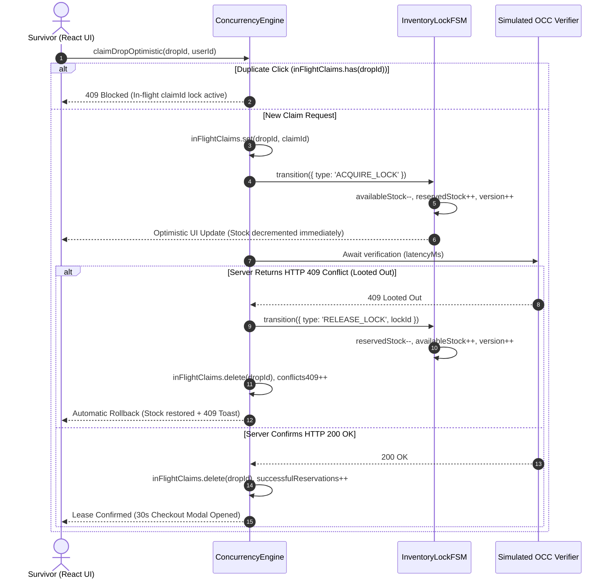

# PROJECT_STRUCTURE.md

## Homework 3: KRAFTON x PUBG Vietnam Championship & Airdrop Arena

**Course:** Web Application Development (Lab 03 — Homework 3)  
**Student:** Nguyen Bao Chinh (MSSV: 24520225)  
**Project:** KRAFTON x PUBG Vietnam Championship & Airdrop Arena  
**Foundation:** Upgraded from Lab 02 HW3 (`High-Concurrency Flash-Sale E-Commerce Engine`)  
**Core Technologies:** React 19 (`19.3.1`), TypeScript 5 (`strict: true`), Vite 5, Zero-Drift Airdrop Countdown (`usePubgAirdropTimer` + `requestAnimationFrame`), Finite State Machine (`InventoryLockFSM`), Optimistic Concurrency Control (`ConcurrencyEngine`), `Intl.NumberFormat('vi-VN')`.

---

## 1. Updated Project Directory Tree

```text
24520225_NguyenBaoChinh_Lab03_HW3/
├── index.html                           # [Upgraded] KRAFTON x PUBG Vietnam Arena HTML5 host shell
├── package.json                         # [Upgraded] React 19 (^19.0.0), TypeScript 5, Vite 5 scripts
├── package-lock.json                    # [Upgraded] Deterministic dependency lockfile (React 19.3.1)
├── tsconfig.json                        # [Upgraded] Strict TypeScript config with allowJs: true
├── vite.config.ts                       # [Retained] Vite bundler configuration (port 3001)
├── TASK_DECOMPOSITION.md                # [Upgraded] Homework 3 WBS, phases, dependencies & checklist
├── PROJECT_STRUCTURE.md                 # [Upgraded] Architecture, retained vs new modules & lifecycles
├── AI_FAILURE_AUDIT.md                  # [Upgraded] 4 verified AI failure modes with DevTools proofs
├── README.md                            # [Upgraded] Overview, domain contracts & execution guide
└── src/
    ├── main.tsx                         # [Retained] React 19 createRoot entrypoint under StrictMode
    ├── types.ts                         # [Upgraded] Lab 02 FSM types + PUBG Domain Contracts
    ├── anti-drift-timer.ts              # [Retained] Lab 02 rAF zero-drift timer, formatCountdown & CPU block
    ├── inventory-state-machine.ts       # [Retained] Lab 02 7-state InventoryLockFSM & 30s lease TTL
    ├── concurrency-engine.ts            # [Upgraded] Lab 02 OCC engine + claimDropOptimistic & 409 rollback
    ├── products-data.ts                 # [Upgraded] PVS VIP Tickets, G-Coin Crates, PUBG VN Squads & Kill-Feed
    ├── telemetry-verifier.ts            # [Upgraded] Automated OCC, drift & PUBG Arena verification suite
    ├── App.tsx                          # [Upgraded] KRAFTON x PUBG Vietnam Arena UI, Leaderboard & Kill-Feed
    ├── App.css                          # [Upgraded] Responsive esports dark glassmorphism styling
    └── hooks/
        ├── usePubgAirdropTimer.js       # [New HW3] Exact zero-drift PUBG airdrop countdown hook (Image 3)
        └── usePubgAirdropTimer.d.ts     # [New HW3] Strict TypeScript declaration for usePubgAirdropTimer
```

---

## 2. Existing Lab 02 Modules Retained vs. New PUBG Modules

### 2.1. Existing Lab 02 Modules Retained
1. **`src/inventory-state-machine.ts` (`InventoryLockFSM`):**
   - Retained 100% intact. Enforces the 7-state lifecycle (`AVAILABLE`, `RESERVED`, `CHECKING_OUT`, `PURCHASED`, `LOCK_EXPIRED`, `CANCELLED`, `OUT_OF_STOCK`), 30-second lease timeouts, `destroy()` timer cleanup, and the mathematical invariant $\text{totalStock} = \text{availableStock} + \text{reservedStock} + \text{soldStock}$.
2. **`src/anti-drift-timer.ts` (`createAntiDriftTimer`, `createDriftProneIntervalTimer`, `formatCountdown`, `blockMainThreadSync`):**
   - Retained 100% intact. Used to format countdown digits (`HH:MM:SS.mmm`) for both the arena wave and individual crate cards, and powers the side-by-side Zero-Drift vs. Naive `setInterval` benchmark and 300ms CPU lag stress test.
3. **`src/concurrency-engine.ts` (`ConcurrencyEngine` core methods):**
   - Retains `reserveItem`, `checkoutOrder`, `releaseLock`, `simulateBotFlood`, `verifyInventoryInvariant`, `resetInventory`, and `destroy`.

### 2.2. New & Upgraded Homework 3 PUBG Modules
1. **`src/hooks/usePubgAirdropTimer.js` (+ `.d.ts`):**
   - New React hook implementing the exact Image 3 contract (`usePubgAirdropTimer(targetEpochMs, serverOffsetMs = 0)`), synchronizing every `200ms` via `window.setInterval` and immediately on tab wake via `document.addEventListener('visibilitychange', onWake)`.
2. **`src/types.ts` (PUBG Domain Contracts):**
   - Adds `DropPhase`, `PubgCrateDrop`, and `PubgVnSquadStanding` with exact `readonly` modifiers alongside Lab 02's `LockState` and `ProductInventory` interfaces.
3. **`src/concurrency-engine.ts` (`claimDropOptimistic` & `inFlightClaims`):**
   - Extends `ConcurrencyEngine` with `claimDropOptimistic`, `getInFlightClaimId`, and `hasInFlightClaim` to orchestrate optimistic stock decrements, in-flight `claimId` duplicate click prevention, and automatic `RELEASE_LOCK` rollback upon HTTP `409 Conflict (Looted Out)`.
4. **`src/products-data.ts` (PUBG Arena Catalog, Squads & Kill-Feed):**
   - Defines `INITIAL_CRATE_DROPS` (`PubgCrateDrop[]`), `INITIAL_SQUAD_STANDINGS` (`PubgVnSquadStanding[]` for `te`, `ces`, `ge`, `agg`), `INITIAL_KILL_FEED`, and `SQUAD_ROSTERS`.
5. **`src/App.tsx` & `src/App.css` (PUBG Vietnam Arena UI):**
   - Introduces `PubgCrateDropCard` component binding `usePubgAirdropTimer` per drop, optimistic claim & 409 rollback control bar, toast notifications, and the PVS Squad Leaderboard & Live Kill-Feed panel.

---

## 3. File Responsibilities Matrix

| File | Status | Primary Responsibility | Key Exports |
| :--- | :---: | :--- | :--- |
| `src/types.ts` | Upgraded | Type and interface contracts for PUBG drops, squad standings, and FSM locks | `DropPhase`, `PubgCrateDrop`, `PubgVnSquadStanding`, `LockState`, `ProductInventory`, `InventoryLockLease` |
| `src/hooks/usePubgAirdropTimer.js` | **New** | Zero-drift React countdown hook with 200ms sync and `visibilitychange` wake recovery | `usePubgAirdropTimer` |
| `src/anti-drift-timer.ts` | Retained | Precision time formatting, rAF timer, drift benchmark, and synchronous CPU blocker | `createAntiDriftTimer`, `createDriftProneIntervalTimer`, `formatCountdown`, `blockMainThreadSync` |
| `src/inventory-state-machine.ts` | Retained | Per-product Finite State Machine enforcing stock conservation and 30s lease expiry | `InventoryLockFSM`, `FSMEvent`, `FSMTransitionResult` |
| `src/concurrency-engine.ts` | Upgraded | Multi-drop FSM coordinator, `claimId` lock guard, HTTP 409 rollback, and bot flood engine | `ConcurrencyEngine` |
| `src/products-data.ts` | Upgraded | PVS VIP Tickets, G-Coin Crates, PUBG VN Squads (`te`, `ces`, `ge`, `agg`), and kill-feed data | `INITIAL_CRATE_DROPS`, `INITIAL_PRODUCTS`, `INITIAL_SQUAD_STANDINGS`, `INITIAL_KILL_FEED` |
| `src/telemetry-verifier.ts` | Upgraded | Automated test suite verifying OCC invariants, timer drift, 409 rollback, and leaderboard | `runConcurrencyInvariantTest`, `benchmarkTimerDrift`, `runPubgArenaVerificationSuite` |
| `src/App.tsx` | Upgraded | Main React 19 arena interface, crate cards, leaderboard, kill-feed, and concurrency console | `App`, `formatVnd` |

---

## 4. Type and Interface Contracts

```typescript
export type DropPhase = 'WARMUP' | 'AIRDROP_LIVE' | 'LOOTED_OUT' | 'EXPIRED';

export interface PubgCrateDrop {
  readonly id: string;
  readonly title: string;
  readonly priceVnd: number;
  readonly remainingStock: number;
  readonly dropEpochMs: number;
}

export interface PubgVnSquadStanding {
  readonly squadId: string;
  readonly squadName: string;
  readonly wwcdCount: number;
  readonly placementPts: number;
  readonly killPts: number;
}
```

---

## 5. Lifecycles, State Transitions & Data Flow

### 5.1. Countdown Lifecycle (`usePubgAirdropTimer`)
1. **Initialization:** Computes initial `remainingMs = Math.max(0, targetEpochMs - (Date.now() + serverOffsetMs))`.
2. **Active Tick (200ms):** Every `200ms`, `syncClock()` recomputes `calcRemaining()` from absolute wall-clock time `Date.now() + serverOffsetMs`.
3. **Tab Wake Synchronization (`visibilitychange`):** When a backgrounded tab returns to `document.visibilityState === 'visible'`, `onWake()` immediately invokes `syncClock()` to eliminate background throttling lag.
4. **Expiration Transition:** When `remainingMs === 0`, `isLive` transitions from `false` to `true`, switching `DropPhase` from `'WARMUP'` to `'AIRDROP_LIVE'`.
5. **Unmount Cleanup:** Clears `timerId` via `window.clearInterval(timerId)` and detaches `onWake` via `document.removeEventListener('visibilitychange', onWake)`.

### 5.2. Optimistic Claim & HTTP 409 Rollback Lifecycle



### 5.3. Inventory State Transitions (`InventoryLockFSM` + `DropPhase`)
- **UI `DropPhase` Derivation:**
  - `'WARMUP'`: `!isLive` (`remainingMs > 0`)
  - `'AIRDROP_LIVE'`: `isLive && remainingStock > 0 && !forceExpired`
  - `'LOOTED_OUT'`: `remainingStock <= 0`
  - `'EXPIRED'`: `forceExpired || arenaWaveRemainingMs === 0`
- **Engine `LockState` Transitions:**
  - `AVAILABLE` $\xrightarrow{\text{ACQUIRE\_LOCK}}$ `RESERVED` (optimistic stock decrement)
  - `RESERVED` $\xrightarrow{\text{RELEASE\_LOCK (409 Rollback / Cancel)}}$ `CANCELLED` (stock restored to `availableStock`)
  - `RESERVED` $\xrightarrow{\text{EXPIRE\_LOCK (30s TTL)}}$ `LOCK_EXPIRED` (stock restored to `availableStock`)
  - `RESERVED` $\xrightarrow{\text{COMPLETE\_PURCHASE}}$ `PURCHASED` (`reservedStock` moved permanently to `soldStock`)

### 5.4. Leaderboard & Live Kill-Feed Data Flow
1. **Source State:** `squadStandings` holds `readonly PubgVnSquadStanding[]` for `te` (The Expendables), `ces` (Cerberus Esports), `ge` (Roy Esports), and `agg` (AGG).
2. **Live Auto-Polling (`AbortController` Protected):** Every `4500ms` (when active), `triggerLiveKillEvent` uses `pollCounterRef` and functional state updates (`setSquadStandings(prev => ...)` and `setKillFeed(prev => ...)`) to append a new match elimination and increment the attacker squad's `killPts` (and `+10 placementPts` / `+1 wwcdCount` on WWCD finishers).
3. **Pure Render Derivation (`useMemo`):** `filteredAndSortedStandings` filters by `selectedSquadFilter`, `squadSearchQuery`, and `minWwcdFilter`, computes `totalPts = sq.placementPts + sq.killPts`, and sorts by `TOTAL_PTS`, `KILL_PTS`, `PLACEMENT_PTS`, or `WWCD` in `DESC` or `ASC` order without mutating `PubgVnSquadStanding`.

---

## 6. React Component Architecture

- **`<App />` (`src/App.tsx`):**
  - Top-level state coordinator binding `ConcurrencyEngine`, main arena `usePubgAirdropTimer`, optimistic claim controls, toast notifications, `<PubgCrateDropCard />` grid, PVS Squad Leaderboard & Kill-Feed section, Concurrency Bot Sniper Lab, and Checkout Modal.
- **`<PubgCrateDropCard />` (`src/App.tsx`):**
  - Encapsulates per-drop `usePubgAirdropTimer(drop.dropEpochMs, serverOffsetMs)`, derives `DropPhase`, renders `Intl.NumberFormat('vi-VN')` pricing, stock meter bar, active `claimId` lock badge, and claim/checkout actions.
