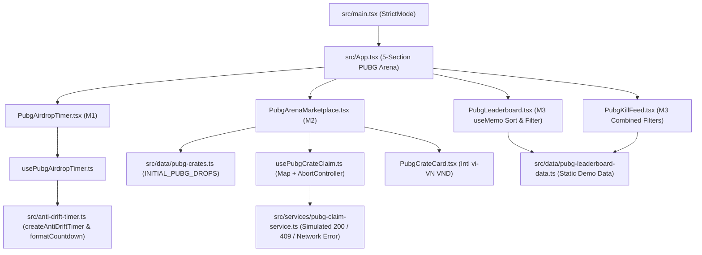

# PROJECT_STRUCTURE.md — Technical Architecture & Repository Map

**Project:** HW3: KRAFTON x PUBG Vietnam Championship & Airdrop Arena  
**Student:** Nguyen Bao Chinh (MSSV: 24520225)  
**Course:** Web Application Development — Lab 03 Homework 3  
**Workspace Root:** `24520225_NguyenBaoChinh_Lab03_HW3/`  

---

## 1. Project Overview

This repository refactors and migrates the **Lab 02 Homework 3 High-Concurrency Engine** (`7ba66d9`) into the **React 19 KRAFTON x PUBG Vietnam Championship & Airdrop Arena** single-page application.

All obsolete 11.11 Flash-Sale e-commerce UI sections, consumer electronics products, shopping vouchers, shipping/payment forms, and checkout modals have been removed from the rendered application (`index.html`, `src/App.tsx`, `src/App.css`, and deleted `src/products-data.ts`), while preserving and actively reusing Lab 2's core timing and optimistic concurrency engineering modules.

The application renders a five-part PUBG esports command interface:

1. **Championship Hero (`src/App.tsx`):** KRAFTON x PUBG Vietnam Series branding, event overview, featured pro squads (`TE`, `CES`, `ROY`, `AGG`), and interactive server-clock offset selector (`0 ms`, `+2000 ms`, `-2000 ms`).
2. **M1 — Zero-Drift Airdrop Countdown (`PubgAirdropTimer` + `usePubgAirdropTimer`):** Epoch-anchored countdown (`Math.max(0, targetEpochMs - (Date.now() + serverOffsetMs))`) reusing Lab 2's `createAntiDriftTimer` (`requestAnimationFrame` + wall-clock delta) and `formatCountdown` (`HH:MM:SS`), paired with `200ms` interval sync, `visibilitychange` background-tab recovery, and all four `DropPhase` states (`WARMUP`, `AIRDROP_LIVE`, `LOOTED_OUT`, `EXPIRED`).
3. **M2 — PVS Grand Finals Rewards Marketplace (`PubgArenaMarketplace` + `PubgCrateCard` + `usePubgCrateClaim` + `claimPubgDrop`):** Optimistic inventory claiming for *PVS Grand Finals VIP Tickets* (`500.000 ₫`) and *PUBG Vietnam G-Coin Crates* (`200.000 ₫`) formatted via `Intl.NumberFormat('vi-VN', { style: 'currency', currency: 'VND' })`, guarded by a synchronous `Map<string, string>` lock (`dropId -> claimId`), `AbortController` teardown, and bounded `+1` stock rollback on simulated HTTP `409` conflicts or network errors (`503`).
4. **M3 — PUBG Vietnam Leaderboard (`PubgLeaderboard`):** Accessible, non-mutating `useMemo` standings table for *The Expendables* (`te`), *Cerberus Esports* (`ces`), *Roy Esports* (`roy`), and *AGG* (`agg`) supporting squad filtering and ascending/descending sorting across `wwcdCount`, `placementPts`, and `killPts`.
5. **M3 — Live Kill-Feed (`PubgKillFeed`):** Multi-filter combat telemetry stream supporting combined squad + event-type (`ALL`, `KILL`, `KNOCK`, `ELIMINATION`) filtering, empty-state handling, and immutable source preservation.

---

## 2. Technology Stack

Verified directly from `package.json` and `node_modules/*/package.json`:

| Package / Tool | Declared in `package.json` | Installed in `node_modules` | Role in Project |
|---|---|---|---|
| `react` | `^19.3.1` | `19.3.1` | React 19 UI runtime (`useState`, `useEffect`, `useMemo`, `useRef`, `StrictMode`) |
| `react-dom` | `^19.3.1` | `19.3.1` | React 19 DOM root hydration/rendering (`ReactDOM.createRoot`) |
| `@types/react` | `^19.3.0` | `19.3.0` | TypeScript declarations for React 19 |
| `@types/react-dom` | `^19.3.0` | `19.3.0` | TypeScript declarations for React DOM 19 |
| `typescript` | `^5.6.3` | `5.6.3` | Strict compiler (`strict: true`, `noUnusedLocals: true`, `noUnusedParameters: true`) |
| `vite` | `^5.4.10` | `5.4.21` | Dev server (port `3001`) and Rollup/esbuild production bundler |
| `@vitejs/plugin-react` | `^4.3.3` | `4.3.3` | Fast Refresh & automatic JSX runtime transform |

---

## 3. Complete Project Tree

Verified directly from the current workspace after refactoring (`19` files under `src/`; obsolete `src/products-data.ts` removed):

```text
24520225_NguyenBaoChinh_Lab03_HW3/
├── .gitignore                             # [Retained] Ignores node_modules, dist, logs, editor files
├── AI_FAILURE_AUDIT.md                    # [HW3 Updated] Audit of 4 genuine AI bugs & manual fixes
├── PROJECT_STRUCTURE.md                   # [HW3 Updated] Architecture map & Lab 2 -> HW3 reuse matrix
├── README.md                              # [Retained] Original Lab 2 baseline README reference
├── TASK_DECOMPOSITION.md                  # [HW3 Updated] Milestone breakdown (M0-M6) & verification status
├── index.html                             # [HW3 Refactored] PUBG Arena metadata & <div id="root"></div>
├── package-lock.json                      # [HW3 Updated] Lockfile with React 19.3.1
├── package.json                           # [HW3 Updated] React 19.3.1 + TypeScript 5.6.3 + Vite 5.4
├── tsconfig.json                          # [Retained] Strict TypeScript configuration
├── vite.config.ts                         # [Retained] Vite React plugin & port 3001 configuration
├── dist/                                  # [Verified Build] Fresh production output (tsc && vite build)
│   ├── index.html
│   └── assets/
│       ├── index-BexohGSk.css
│       └── index-BVLu2F2i.js
└── src/
    ├── App.css                            # [HW3 Refactored] Dark navy/obsidian + PUBG gold/orange esports UI
    ├── App.tsx                            # [HW3 Refactored] 5-section PUBG Vietnam Championship & Airdrop Arena
    ├── anti-drift-timer.ts                # [Lab 2 Reused] Active source of createAntiDriftTimer & formatCountdown
    ├── concurrency-engine.ts              # [Lab 2 Reference] Preserved Lab 2 multi-SKU concurrency coordinator
    ├── inventory-state-machine.ts         # [Lab 2 Reference] Preserved Lab 2 InventoryLockFSM reference
    ├── main.tsx                           # [Retained] ReactDOM.createRoot(<React.StrictMode><App /></React.StrictMode>)
    ├── telemetry-verifier.ts              # [Lab 2 Reference] Preserved Lab 2 invariant & drift benchmark utilities
    ├── types.ts                           # [Lab 2 Reference] Type definitions supporting preserved Lab 2 modules
    ├── components/
    │   ├── PubgAirdropTimer.tsx           # [HW3 M1] Zero-drift countdown UI + 4 DropPhase states + presets
    │   ├── PubgArenaMarketplace.tsx       # [HW3 M2] PVS VIP Ticket & G-Coin marketplace + Claim Activity log
    │   ├── PubgCrateCard.tsx              # [HW3 M2] Reward card with vi-VN VND price, stock bar & fault buttons
    │   ├── PubgKillFeed.tsx               # [HW3 M3] Squad + event-type filterable combat kill-feed
    │   └── PubgLeaderboard.tsx            # [HW3 M3] Filterable & sortable PUBG Vietnam 4-squad standings table
    ├── data/
    │   ├── pubg-crates.ts                 # [HW3 M2] INITIAL_PUBG_DROPS (VIP Ticket & G-Coin Crate catalog)
    │   └── pubg-leaderboard-data.ts       # [HW3 M3] INITIAL_SQUAD_STANDINGS & INITIAL_KILL_FEED demo data
    ├── hooks/
    │   ├── usePubgAirdropTimer.ts         # [HW3 M1] Epoch-anchored hook reusing createAntiDriftTimer
    │   └── usePubgCrateClaim.ts           # [HW3 M2] Map<dropId, claimId> lock, optimistic -1 & 409/503 rollback
    ├── services/
    │   └── pubg-claim-service.ts          # [HW3 M2] Simulated 800ms claim API supporting AbortSignal, 200 & 409
    └── types/
        └── pubg-vn-arena-contract.ts          # [HW3 Contracts] DropPhase, PubgCrateDrop, PubgVnSquadStanding, etc.
```

---

## 4. Lab 2 → HW3 Engineering Reuse & Migration Map

| Lab 2 Source File & Symbol | Reusable Engineering Principle | HW3 Destination & Adaptation | Reuse Type |
|---|---|---|---|
| `src/anti-drift-timer.ts` → `createAntiDriftTimer(durationMs, onTick)` | `requestAnimationFrame` loop recalculating `Math.max(0, targetTime - Date.now())` with explicit `cancelAnimationFrame` disposal | Directly imported and invoked inside `src/hooks/usePubgAirdropTimer.ts` alongside `200ms` background sync + `visibilitychange` wake listener | **Direct Code Import** |
| `src/anti-drift-timer.ts` → `formatCountdown(ms)` | Zero-padded `HH:MM:SS` breakdown (`hours`, `minutes`, `seconds`) with `Math.max(0, ...)` floor clamping | Directly imported and invoked inside `src/components/PubgAirdropTimer.tsx` to render digital countdown segments | **Direct Code Import** |
| `src/inventory-state-machine.ts` → `InventoryLockFSM` (`activeLeases: Map`, `+1` rollback, `408`/`409`/`410` codes, `destroy()`) | Map-keyed active lock tracking, optimistic `-1` deduction, bounded `+1` rollback, and unmount timer cleanup | Adapted into React 19 hook `src/hooks/usePubgCrateClaim.ts` (`inFlightClaims: Map<string, string>`, `activeControllers: Map<string, AbortController>`, `maxCapacityMap`, HTTP `200`/`408`/`409`/`410`/`503`) | **Architectural Pattern Adaptation** |
| `src/App.tsx` (Lab 2 `formatVND`) | Vietnamese Dong currency formatting via `Intl.NumberFormat('vi-VN', { style: 'currency', currency: 'VND' })` | Implemented in `src/components/PubgCrateCard.tsx` (`formatPriceVnd`) | **Standardized Formatter Migration** |
| `src/products-data.ts` (`INITIAL_PRODUCTS`, `FLASH_VOUCHERS`) | Obsolete 11.11 e-commerce product & voucher catalog | **Removed**; replaced by `src/data/pubg-crates.ts` (`INITIAL_PUBG_DROPS`) and `src/data/pubg-leaderboard-data.ts` | **Domain Replacement** |

---

## 5. Module-by-Module Responsibilities

### 5.1 Entrypoint & Application Shell
- **`index.html`:** Declares KRAFTON x PUBG Vietnam page metadata, Google Fonts (`Outfit` and `JetBrains Mono`), and `<div id="root"></div>`.
- **`src/main.tsx`:** Mounts `<App />` inside `<React.StrictMode>` so all hook mount/cleanup cycles are double-invoked in development.
- **`src/App.tsx`:** Root layout orchestrating the 5 required sections (`header.pubg-hero`, `PubgAirdropTimer`, `PubgArenaMarketplace`, `PubgLeaderboard`, `PubgKillFeed`, and `footer.pubg-footer`). Holds `airdropTargetMs`, `serverOffsetMs`, `allCratesLooted`, and `isArenaExpired` state without re-rendering sibling modules on 1-second timer ticks.
- **`src/App.css`:** Tactical dark-navy (`#060911`, `#0b1120`, `#10192d`) and PUBG gold/orange (`#f59e0b`, `#fbbf24`, `#ea580c`) stylesheet with responsive grid breakpoints (`980px`, `640px`) and `:focus-visible` keyboard accessibility rings.

### 5.2 M1 — Zero-Drift Airdrop Countdown
- **`src/hooks/usePubgAirdropTimer.ts`:** Exports `usePubgAirdropTimer(targetEpochMs, serverOffsetMs = 0, liveWindowMs = 900000)`. Computes `Math.max(0, targetEpochMs - (Date.now() + serverOffsetMs))`, runs `createAntiDriftTimer` + `200ms` interval + `document.addEventListener('visibilitychange', onWake)`, updates React state only on second boundaries (`Math.ceil(ms / 1000)`), cleans up all handles on teardown/prop change, and returns `{ remainingMs, isLive, isExpired, phase }`.
- **`src/components/PubgAirdropTimer.tsx`:** Formats `remainingMs` via `formatCountdown`, derives `effectivePhase` (`WARMUP`, `AIRDROP_LIVE`, `LOOTED_OUT`, `EXPIRED`), displays `HH:MM:SS` digits + live status banner, and exposes interactive phase verification presets.

### 5.3 M2 — Optimistic Claim & 409 Rollback
- **`src/data/pubg-crates.ts`:** Defines `INITIAL_PUBG_DROPS` (`pvs-vip-001` *PVS Grand Finals VIP Ticket* at `500000` VND, stock `20`; `gcoin-crate-001` *PUBG Vietnam G-Coin Crate* at `200000` VND, stock `50`).
- **`src/services/pubg-claim-service.ts`:** Clearly labeled client-side mock service `claimPubgDrop({ claimId, dropId, forceConflict, simulateNetworkError, signal })` with `800ms` latency, `AbortSignal` timeout cancellation, simulated network exception, HTTP `409` conflict, and HTTP `200` confirmation.
- **`src/hooks/usePubgCrateClaim.ts`:** Maintains `inFlightClaims = useRef<Map<string, string>>(new Map())` (`dropId -> claimId`), `dropsRef` synchronous state mirror, `activeControllers` (`Map<string, AbortController>`), `inventoryEpochRef` stale-completion guard, and `maxCapacityMap` conservation cap. Handles duplicate-click rejection, HTTP `408` expired drops, HTTP `410` `LOOTED_OUT`, optimistic `-1` deduction, HTTP `409` & `503` `+1` rollback, and `finally` lock cleanup.
- **`src/components/PubgCrateCard.tsx` & `src/components/PubgArenaMarketplace.tsx`:** Render reward cards with `vi-VN` VND currency formatting, progress bars, live `LOCK: <claimId>` indicators, fault-injection test buttons (`Test HTTP 409 Rollback`, `Test Network Failure`), `Reset Stock`, and stable `key={result.claimId}` activity telemetry.

### 5.4 M3 — PUBG Vietnam Leaderboard & Live Kill-Feed
- **`src/data/pubg-leaderboard-data.ts`:** Static client-side demo datasets `INITIAL_SQUAD_STANDINGS` (`te`, `ces`, `roy`, `agg`) and `INITIAL_KILL_FEED` (`KILL`, `KNOCK`, `ELIMINATION`).
- **`src/components/PubgLeaderboard.tsx`:** Pure `useMemo` derivation filtering by squad and sorting `[...filtered]` by `wwcdCount`, `placementPts`, or `killPts` (`asc`/`desc`) with deterministic alphabetical tie-breaking and semantic `<table>` / `<th scope="col|row">` markup.
- **`src/components/PubgKillFeed.tsx`:** Pure `useMemo` derivation combining squad + event-type filters, chronological `[...filtered].sort((a, b) => b.timestamp - a.timestamp)` ordering, filter-reset button, and accessible empty-result state.

---

## 6. Architecture & Data-Flow Diagram


