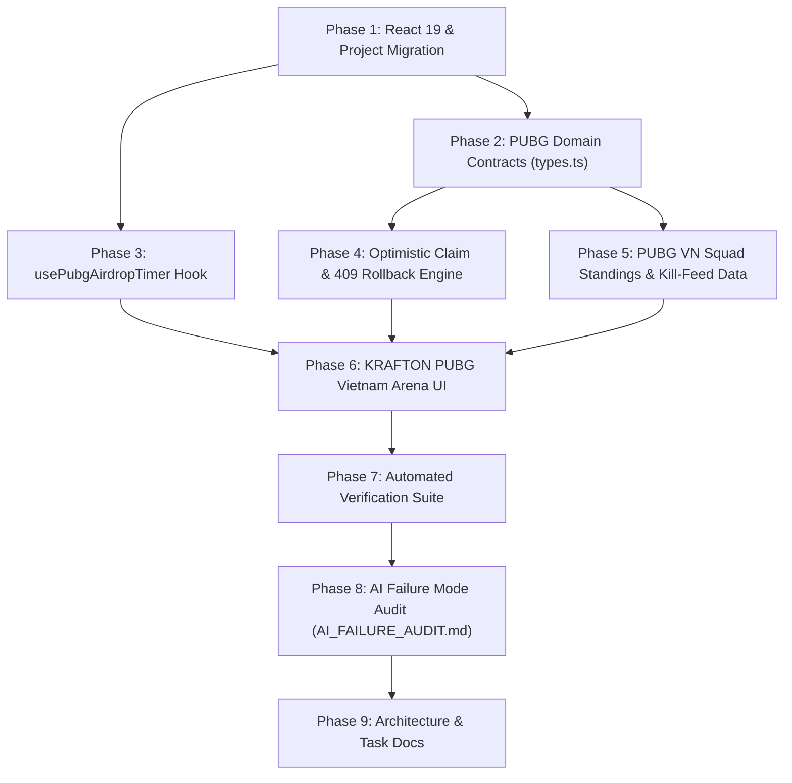

# TASK_DECOMPOSITION.md

## Homework 3: KRAFTON x PUBG Vietnam Championship & Airdrop Arena

**Course:** Web Application Development (Lab 03 — Homework 3)  
**Student:** Nguyen Bao Chinh (MSSV: 24520225)  
**Project:** KRAFTON x PUBG Vietnam Championship & Airdrop Arena  
**Foundation:** Upgraded from Lab 02 HW3 (`High-Concurrency Flash-Sale E-Commerce Engine`)  

---

## 1. Homework 3 Objectives

1. **Preserve & Upgrade Lab 02 Foundation:** Retain Lab 02's `InventoryLockFSM`, `ConcurrencyEngine`, and `anti-drift-timer.ts` while upgrading the platform to React 19 (`19.3.1`) and transforming the domain into **KRAFTON x PUBG Vietnam Championship & Airdrop Arena**.
2. **Enforce Strict Domain & Hook Contracts (Images 2 & 3):**
   - Preserve `DropPhase`, `PubgCrateDrop`, and `PubgVnSquadStanding` with exact property names, types, and `readonly` modifiers.
   - Implement `src/hooks/usePubgAirdropTimer.js` with exact `calcRemaining`, `200ms` interval sync, and `visibilitychange` wake listener.
   - Format all VND currency values via `Intl.NumberFormat('vi-VN')`.
3. **Deliver Core Arena Features:**
   - **Feature 1:** Zero-Drift Airdrop & PVS Finals Ticket Countdown.
   - **Feature 2:** Optimistic Crate/Ticket Claim with in-flight `claimId` lock deduplication and automatic HTTP 409 Conflict (`409 Looted Out`) inventory rollback.
   - **Feature 3:** PUBG Vietnam Squad Leaderboard (`te` — The Expendables, `ces` — Cerberus Esports, `ge` — Roy Esports, `agg` — AGG) & Live Kill-Feed with derived total points, sorting, and filtering.
4. **Verify & Document AI Failure Modes (Image 4):**
   - Audit, reproduce, and fix Stale Closures in Auto-Polling, Redundant `useEffect` for Derived State, Missing `AbortController` / Async Cleanup, and Naive `setInterval` Countdown Drift in `AI_FAILURE_AUDIT.md`.

---

## 2. Work Breakdown Structure (WBS) & Implementation Phases

### Phase 1: Project Migration & React 19 Upgrade
- **Files:** `package.json`, `package-lock.json`, `tsconfig.json`, `index.html`
- **Tasks:**
  - Audit existing Lab 02 repository, dependencies, and Git history.
  - Upgrade `react`, `react-dom`, `@types/react`, and `@types/react-dom` to React 19 (`19.3.1` / `19.3.0`).
  - Enable `allowJs: true` in `tsconfig.json` for seamless `.js` + `.d.ts` hook integration.
  - Update `index.html` branding for KRAFTON x PUBG Vietnam Championship & Airdrop Arena.

### Phase 2: PUBG Domain Contracts
- **Files:** `src/types.ts`
- **Tasks:**
  - Define exact `DropPhase = 'WARMUP' | 'AIRDROP_LIVE' | 'LOOTED_OUT' | 'EXPIRED'`.
  - Define exact `PubgCrateDrop` and `PubgVnSquadStanding` interfaces with `readonly` properties.
  - Retain Lab 02 `LockState`, `ProductInventory`, `InventoryLockLease`, `OrderRecord`, `ConcurrencyLogEntry`, and `ConcurrencyMetrics`.

### Phase 3: Zero-Drift PUBG Airdrop Countdown Hook
- **Files:** `src/hooks/usePubgAirdropTimer.js`, `src/hooks/usePubgAirdropTimer.d.ts`, `src/anti-drift-timer.ts`
- **Tasks:**
  - Implement `usePubgAirdropTimer(targetEpochMs, serverOffsetMs = 0)` verbatim per Image 3 contract.
  - Add TypeScript declaration file `usePubgAirdropTimer.d.ts`.
  - Reuse `formatCountdown`, `createAntiDriftTimer`, `createDriftProneIntervalTimer`, and `blockMainThreadSync` from `src/anti-drift-timer.ts`.

### Phase 4: Optimistic Crate & Ticket Claim Engine with HTTP 409 Rollback
- **Files:** `src/concurrency-engine.ts`, `src/inventory-state-machine.ts`, `src/products-data.ts`
- **Tasks:**
  - Configure PVS Grand Finals VIP Ticket and G-Coin Crate drops in `src/products-data.ts`.
  - Add `inFlightClaims` map and `claimDropOptimistic` to `ConcurrencyEngine`, reusing `InventoryLockFSM` transitions (`ACQUIRE_LOCK` for optimistic decrement and `RELEASE_LOCK` for automatic HTTP 409 Looted Out rollback).

### Phase 5: PUBG Vietnam Squad Standings & Live Kill-Feed Data
- **Files:** `src/products-data.ts`
- **Tasks:**
  - Configure `INITIAL_SQUAD_STANDINGS` for The Expendables (`te`), Cerberus Esports (`ces`), Roy Esports (`ge`), and AGG (`agg`).
  - Configure `INITIAL_KILL_FEED`, `SQUAD_ROSTERS`, `PUBG_WEAPONS`, and `PUBG_MAPS`.

### Phase 6: KRAFTON x PUBG Vietnam Arena UI
- **Files:** `src/App.tsx`, `src/App.css`, `README.md`
- **Tasks:**
  - Build `<PubgCrateDropCard />` integrating `usePubgAirdropTimer` per drop and deriving `DropPhase`.
  - Build optimistic claim control bar (`Simulate Server HTTP 409 Looted Out`, `Force EXPIRED DropPhase`) and toast notification stack.
  - Build PUBG Vietnam Squad Standings table with derived `totalPts = placementPts + killPts`, multi-column sorting (`TOTAL_PTS`, `KILL_PTS`, `PLACEMENT_PTS`, `WWCD`), squad filter pills, search filter, and live kill-feed with `AbortController` auto-polling.
  - Format all VND prices using `new Intl.NumberFormat('vi-VN')`.

### Phase 7: Automated Telemetry & Behavior Verification
- **Files:** `src/telemetry-verifier.ts`, `src/App.tsx`
- **Tasks:**
  - Implement `runPubgArenaVerificationSuite()` verifying countdown expiration, visibilitychange sync, duplicate `claimId` lock prevention, 200 OK claim, HTTP 409 rollback, stock conservation, leaderboard sorting/filtering, and unmount cleanup.

### Phase 8: AI Failure Mode Audit Documentation
- **Files:** `AI_FAILURE_AUDIT.md`
- **Tasks:**
  - Document Failures #01–#04 (Stale Closures in Auto-Polling, Redundant `useEffect` for Derived State, Missing `AbortController` / Async Cleanup, Naive `setInterval` Countdown Drift) with Prompt, AI Code, Bug, DevTools Proof, Engineering Fix, and Commit SHA.

### Phase 9: Architecture & Task Decomposition Documentation
- **Files:** `PROJECT_STRUCTURE.md`, `TASK_DECOMPOSITION.md`
- **Tasks:**
  - Document directory tree, retained Lab 02 vs. new PUBG modules, lifecycles, WBS, task dependencies, acceptance criteria, and Git commit milestones.

---

## 3. Task Dependencies

---

## 4. Acceptance Criteria & Testing Procedures

| # | Test Requirement | Testing Procedure | Expected Acceptance Result |
| :-: | :--- | :--- | :--- |
| **1** | **TypeScript & Vite Build** | Run `npm run build` (`tsc && vite build`). | Zero TypeScript errors; production bundle generated in `dist/`. |
| **2** | **Countdown Expiration** | Run `runPubgArenaVerificationSuite` Test #1 or click **Set Wave to 3s** in UI. | `remainingMs` reaches `0`, `isLive` becomes `true`, and `WARMUP` drops transition to `AIRDROP_LIVE`. |
| **3** | **Visibility Synchronization** | Dispatch `visibilitychange` when `document.visibilityState === 'visible'` or click **Simulate Tab Wake**. | `onWake` invokes `syncClock()` immediately, recalibrating `remainingMs` with `0ms` drift. |
| **4** | **Duplicate Claim Prevention** | Dispatch concurrent claims on the same crate while `claimId` is in-flight. | Second click is rejected immediately with `409` due to active `inFlightClaims` lock; only 1 unit is reserved. |
| **5** | **Successful Claim (200 OK)** | Click **CLAIM AIRDROP** with 409 simulation unchecked, then confirm checkout. | Optimistic stock decreases by 1, 30s lease modal opens, and order is recorded in ledger. |
| **6** | **HTTP 409 Rollback** | Enable **Simulate Server HTTP 409 Looted Out** and click **CLAIM AIRDROP**. | Stock decreases optimistically by 1 during in-flight request, then automatically rolls back to original value upon 409 response. |
| **7** | **Stock Conservation** | Run `runConcurrencyInvariantTest(5, 100)` or launch 100 sniper bots in UI. | `availableStock + reservedStock + soldStock === totalStock`, `availableStock >= 0`, `oversellViolations === 0`. |
| **8** | **Leaderboard Filter & Sort** | Filter by `te`, `ces`, `ge`, `agg`, search text, or sort by `TOTAL_PTS` / `KILL_PTS` / `WWCD`. | Total points (`te: 182`, `ces: 180`, `ge: 140`, `agg: 126`) and kill points (`ces: 118`) sort and filter accurately. |
| **9** | **Unmount Cleanup** | Unmount component / call `engine.destroy()` and toggle live auto-polling. | `clearInterval`, `removeEventListener`, and `AbortController.abort()` leave zero orphaned timers or listeners. |

---

## 5. Git Commit Milestones (9 Discrete Conventional Commits)

| # | Commit SHA | Conventional Commit Message | Scope |
| :-: | :--- | :--- | :--- |
| **1** | `e23e8f3` | `chore(project): prepare PUBG Vietnam arena migration` | React 19 upgrade, `tsconfig.json`, `index.html`, Lab 02 baseline |
| **2** | `f5e7dd5` | `feat(types): define PUBG arena domain contracts` | `DropPhase`, `PubgCrateDrop`, `PubgVnSquadStanding` in `src/types.ts` |
| **3** | `751a9f5` | `feat(timer): implement anti-drift PUBG airdrop hook` | `src/hooks/usePubgAirdropTimer.js` & `.d.ts` |
| **4** | `e67db84` | `feat(claim): implement optimistic crate and ticket claims` | `claimDropOptimistic`, `claimId` lock & 409 rollback in `src/concurrency-engine.ts` |
| **5** | `dcbf330` | `feat(leaderboard): add PUBG VN squad standings and kill-feed` | Squads (`te`, `ces`, `ge`, `agg`) & kill-feed in `src/products-data.ts` |
| **6** | `1231090` | `feat(ui): build KRAFTON PUBG Vietnam arena interface` | Full React 19 arena UI in `src/App.tsx`, `src/App.css`, `README.md` |
| **7** | `16c3c06` | `test(arena): verify countdown claim and leaderboard behavior` | `runPubgArenaVerificationSuite` in `src/telemetry-verifier.ts` |
| **8** | `41761b6` | `docs(audit): document verified AI failure modes` | 4 verified failure modes in `AI_FAILURE_AUDIT.md` |
| **9** | *(Current)* | `docs(project): update project structure and task decomposition` | `PROJECT_STRUCTURE.md` & `TASK_DECOMPOSITION.md` |

---

## 6. Completion Checklist

- [x] Inspected existing Lab 02 repository, source files, documentation, `package.json`, `package-lock.json`, and Git history prior to code changes.
- [x] Upgraded React and React DOM to React 19 (`19.3.1`) while preserving Vite and strict TypeScript compatibility.
- [x] Preserved exact `DropPhase`, `PubgCrateDrop`, and `PubgVnSquadStanding` contracts in `src/types.ts`.
- [x] Implemented exact `src/hooks/usePubgAirdropTimer.js` hook contract (200ms sync + `visibilitychange` listener + cleanup).
- [x] Reused Lab 02 `InventoryLockFSM`, `ConcurrencyEngine`, and `anti-drift-timer.ts`.
- [x] Implemented optimistic claiming for PVS Grand Finals VIP Ticket & G-Coin Crates with `claimId` duplicate click prevention and automatic HTTP 409 rollback.
- [x] Implemented PUBG Vietnam Leaderboard & Live Kill-Feed for `The Expendables (te)`, `Cerberus Esports (ces)`, `Roy Esports (ge)`, and `AGG (agg)`.
- [x] Formatted all VND currency values using `Intl.NumberFormat('vi-VN')`.
- [x] Documented 4 verified AI failure modes in `AI_FAILURE_AUDIT.md` following the mandatory template.
- [x] Updated `PROJECT_STRUCTURE.md` and `TASK_DECOMPOSITION.md`.
- [x] Created 9 discrete local Conventional Commits without pushing to GitHub.
