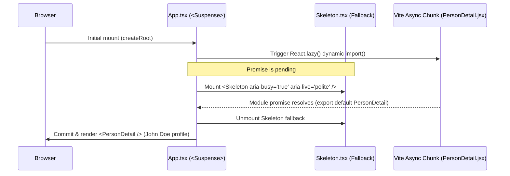

# Project Structure & Architecture — Exercise 1.1: Performance & Resiliency Architectural Upgrades

## 1. Project Overview

This repository (`24520225_NguyenBaoChinh_Lab04_Exercise1.1`) implements **Exercise 1.1: Performance & Resiliency Architectural Upgrades** for Lab 04 of Web Application Development (MSIS207 / UIT).

Exercise 1.1 focuses specifically on **component-level code splitting** (`React.lazy()`) and **resilient asynchronous loading boundaries** (`<Suspense>`) with an accessible WAI-ARIA `Skeleton` fallback component (`aria-busy="true"`, `aria-live="polite"`).

### Relationship Across the Lab 04 Exercise Series
- **Exercise 1.1 (Current Repository)**: Establishes the foundational `PersonDetail` profile card, the accessible `Skeleton` shimmer fallback, and the `React.lazy()` + `<Suspense>` dynamic import boundary.
- **Exercise 1.2 (`24520225_NguyenBaoChinh_Lab04_Exercise1.2`)**: Inherits Exercise 1.1's `PersonDetail` and `Skeleton` components and integrates them into a multi-route React Router v7 layout architecture (`/`, `/people`, `/people/:id`, `*`) with `useParams()`, `people.find()`, semantic `<dl>/<dt>/<dd>` lists, and a 404 entity fallback.
- **Exercise 1.3 (`24520225_NguyenBaoChinh_Lab04_Exercise1.3`)**: Inherits both Exercise 1.1 and Exercise 1.2 and adds the `/validation` route analyzing legacy 5-hook `useEffect` chaining across `InputField` and `SimpleForm`.

Companion Exercise 1.1 Governance Documents:
- [`AI_FAILURE_AUDIT.md`](file:///Users/chinh/UIT%20lecture/WebApplicationDevelopment/Lab/Lab04/Exercise/24520225_NguyenBaoChinh_Lab04_Exercise1.1/AI_FAILURE_AUDIT.md) — Exercise 1.1 technical audit, AI failure modes, and verification matrix.
- [`TASK_DECOMPOSITION.md`](file:///Users/chinh/UIT%20lecture/WebApplicationDevelopment/Lab/Lab04/Exercise/24520225_NguyenBaoChinh_Lab04_Exercise1.1/TASK_DECOMPOSITION.md) — 4-Stage Contract-First roadmap for Exercise 1.1.
- [`project-rules.md`](file:///Users/chinh/UIT%20lecture/WebApplicationDevelopment/Lab/Lab04/Exercise/24520225_NguyenBaoChinh_Lab04_Exercise1.1/project-rules.md) — Mandatory engineering governance and Git safety rules for Exercise 1.1.

---

## 2. Technology Stack (Exercise 1.1)

Inspected directly from [`package.json`](file:///Users/chinh/UIT%20lecture/WebApplicationDevelopment/Lab/Lab04/Exercise/24520225_NguyenBaoChinh_Lab04_Exercise1.1/package.json):

| Category | Package | Version | Role in Exercise 1.1 |
| :--- | :--- | :--- | :--- |
| **UI Library** | `react`, `react-dom` | `^19.3.1` | `React.lazy()` dynamic module loader, `<Suspense>` fallback boundary, functional component rendering |
| **Type System** | `typescript` | `~6.0.3` | Static type checking (`tsc -b`), `SkeletonProps` WAI-ARIA prop contract, mixed `.tsx`/`.jsx` compilation (`allowJs: true`) |
| **Bundler & Dev Server** | `vite`, `@vitejs/plugin-react` | `^8.3.6`, `^6.1.2` | Dynamic ES module chunk splitting (`dist/assets/PersonDetail-*.js`), CSS extraction, and HMR |
| **Linter** | `eslint`, `eslint-plugin-react-hooks`, `typescript-eslint` | `^10.14.0`, `^7.1.1`, `^8.72.1` | Static code quality verification (`npm run lint`) |

*(Note: Unlike Exercises 1.2 and 1.3, Exercise 1.1 does not install `react-router` because it focuses purely on single-view component lazy loading and `<Suspense>` resiliency.)*

---

## 3. Actual Directory Tree (`24520225_NguyenBaoChinh_Lab04_Exercise1.1`)

Generated from the actual files present in `24520225_NguyenBaoChinh_Lab04_Exercise1.1/`:

```text
24520225_NguyenBaoChinh_Lab04_Exercise1.1/
├── AI_FAILURE_AUDIT.md                  # Exercise 1.1 AI failure audit & verification matrix
├── PROJECT_STRUCTURE.md                 # Exercise 1.1 architecture, directory tree & component catalog
├── README.md                            # Project setup and build overview
├── TASK_DECOMPOSITION.md                # Exercise 1.1 4-Stage Contract-First task decomposition
├── project-rules.md                     # Exercise 1.1 development governance & Git safety rules
├── eslint.config.js                     # ESLint v10 flat configuration
├── index.html                           # HTML entry point mounting #root and loading /src/main.tsx
├── package-lock.json                    # npm dependency lockfile
├── package.json                         # Exercise 1.1 dependencies (react, react-dom) and scripts
├── tsconfig.json                        # Root TypeScript solution configuration
├── tsconfig.app.json                    # App TypeScript compiler config (ES2023, bundler, allowJs: true)
├── tsconfig.node.json                   # Node/Vite TypeScript configuration
├── vite.config.ts                       # Vite bundler configuration
├── public/
│   ├── favicon.svg                      # Application favicon
│   └── icons.svg                        # SVG icon assets
└── src/
    ├── main.tsx                         # Primary TypeScript entry point mounting <App /> inside <StrictMode>
    ├── main.jsx                         # Interoperable JSX entry point mounting <App />
    ├── index.css                        # Global typography, color variables, and #root container styles
    ├── App.tsx                          # Root component with React.lazy() + <Suspense fallback={<Skeleton />}> (TSX)
    ├── App.jsx                          # Root component with React.lazy() + <Suspense fallback={<Skeleton />}> (JSX)
    ├── App.css                          # Layout container (.app-container), header, content section, and footer styles
    ├── PersonDetail.tsx                 # TypeScript lazy wrapper around PersonDetail.jsx with <Suspense>
    ├── PersonDetail.jsx                 # Dynamically imported PersonDetail profile card (John Doe)
    ├── PersonDetail.css                 # Profile card layout (.person-detail), avatar (.person-avatar), and field rows
    ├── Skeleton.tsx                     # Accessible WAI-ARIA Skeleton loading placeholder (TypeScript)
    ├── Skeleton.jsx                     # Accessible WAI-ARIA Skeleton loading placeholder (JSX)
    ├── Skeleton.css                     # Shimmer keyframe animation (@keyframes shimmer) and skeleton card geometry
    └── assets/
        ├── hero.png                     # Template hero graphic
        ├── react.svg                    # React logo
        └── vite.svg                     # Vite logo
```

---

## 4. Exercise 1.1 Specific Architecture

### 4.1. Dynamic Code Splitting (`React.lazy`)
In [`src/App.tsx`](file:///Users/chinh/UIT%20lecture/WebApplicationDevelopment/Lab/Lab04/Exercise/24520225_NguyenBaoChinh_Lab04_Exercise1.1/src/App.tsx#L7-L10) (and [`src/App.jsx`](file:///Users/chinh/UIT%20lecture/WebApplicationDevelopment/Lab/Lab04/Exercise/24520225_NguyenBaoChinh_Lab04_Exercise1.1/src/App.jsx#L7-L10)), `PersonDetail` is loaded asynchronously via `React.lazy`:

```tsx
// Dynamic import via React.lazy (temporary 10s delay so you can test in Console)
const PersonDetail = React.lazy(async () => {
  await new Promise((resolve) => setTimeout(resolve, 10000));
  return import('./PersonDetail.jsx');
});
```

Additionally, [`src/PersonDetail.tsx`](file:///Users/chinh/UIT%20lecture/WebApplicationDevelopment/Lab/Lab04/Exercise/24520225_NguyenBaoChinh_Lab04_Exercise1.1/src/PersonDetail.tsx#L6-L8) provides a reusable `PersonDetailLazy` wrapper that dynamically imports `./PersonDetail.jsx` without artificial delay.

When `npm run build` executes:
- Vite's Rollup bundler isolates `PersonDetail.jsx` and `PersonDetail.css` into separate build artifacts (`dist/assets/PersonDetail-*.js` and `dist/assets/PersonDetail-*.css`), keeping them out of the initial main bundle.
- During the simulated `10000ms` network delay in `App.tsx`, the user can inspect the active `<Skeleton />` DOM tree, WAI-ARIA attributes, and network chunk request in Chrome DevTools.

### 4.2. Resilient `<Suspense>` Boundary & WAI-ARIA `Skeleton`
In [`src/App.tsx`](file:///Users/chinh/UIT%20lecture/WebApplicationDevelopment/Lab/Lab04/Exercise/24520225_NguyenBaoChinh_Lab04_Exercise1.1/src/App.tsx#L27-L36), `<PersonDetail />` is wrapped inside `<Suspense>`:

```tsx
<Suspense
  fallback={
    <Skeleton
      aria-busy="true"
      aria-live="polite"
    />
  }
>
  <PersonDetail />
</Suspense>
```

[`src/Skeleton.tsx`](file:///Users/chinh/UIT%20lecture/WebApplicationDevelopment/Lab/Lab04/Exercise/24520225_NguyenBaoChinh_Lab04_Exercise1.1/src/Skeleton.tsx) defines an explicit `SkeletonProps` type:
- `'aria-busy'?: boolean | 'true' | 'false'` (defaults to `'true'`)
- `'aria-live'?: 'off' | 'polite' | 'assertive'` (defaults to `'polite'`)
- Renders `<section className="skeleton-card" aria-busy={ariaBusy} aria-live={ariaLive} aria-label="Loading person details">`.
- Matches the exact geometry of `.person-detail` (`min-height: 320px`, `padding: 32px`, `80px × 80px` circular avatar, name/role headers, divider, and four key-value rows) to prevent Cumulative Layout Shift (CLS) when `PersonDetail` resolves.

---

## 5. Component Responsibilities

| Component | Source File(s) | Responsibilities | Props / State |
| :--- | :--- | :--- | :--- |
| `App` | `src/App.tsx`, `src/App.jsx` | Renders page shell (`.app-container`), header (`Exercise 1.1`), `<Suspense>` boundary, and footer. | Stateless |
| `Skeleton` | `src/Skeleton.tsx`, `src/Skeleton.jsx` | Renders WAI-ARIA accessible shimmer placeholder while lazy chunk resolves. | `SkeletonProps` (`aria-busy`, `aria-live`) |
| `PersonDetail` | `src/PersonDetail.jsx` | Renders the resolved profile card for **John Doe** (`Software Engineer`, `Information Technology`, `Active`). | Stateless |
| `PersonDetailLazy` | `src/PersonDetail.tsx` | Encapsulates `React.lazy(() => import('./PersonDetail.jsx'))` with `<Suspense fallback={<Skeleton />}>`. | Stateless |

---

## 6. Data Flow & Asynchronous Loading Lifecycle



---

## 7. Routing & State Management Scope in Exercise 1.1

- **Routing**: Not applicable in Exercise 1.1. Client-side routing (`react-router` v7) is introduced in **Exercise 1.2**.
- **State Management**: Exercise 1.1 is intentionally stateless at the application data level; asynchronous loading state is managed declaratively by React's concurrent `<Suspense>` boundary rather than manual `isLoading` boolean state hooks.

---

## 8. Testing, Verification & Configuration Structure

- **Build & Chunk Split Verification**: `npm run build` runs `tsc -b && vite build`, verifying that TypeScript compiles with zero errors and that `PersonDetail` is emitted as a separate lazy chunk in `dist/assets/`.
- **Static Analysis**: `npm run lint` runs ESLint v10 across all `.ts` and `.tsx` files.
- **Accessibility & DevTools Inspection**: During the `React.lazy` loading phase, Chrome DevTools Accessibility Tree and Elements panel verify `<section class="skeleton-card" aria-busy="true" aria-live="polite" aria-label="Loading person details">`.
- **TypeScript Configuration ([`tsconfig.app.json`](file:///Users/chinh/UIT%20lecture/WebApplicationDevelopment/Lab/Lab04/Exercise/24520225_NguyenBaoChinh_Lab04_Exercise1.1/tsconfig.app.json))**: Enables `"allowJs": true` and `"moduleResolution": "bundler"` so `.tsx` components can dynamically import `./PersonDetail.jsx` without type resolution errors.
