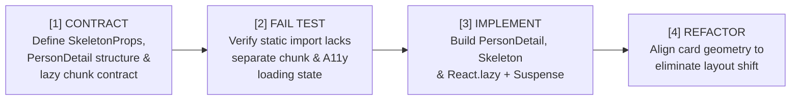

# Task Decomposition & Contract-First Roadmap — Exercise 1.1: Performance & Resiliency Architectural Upgrades

## 1. Mandatory Development Workflow: Strict 4-Stage Contract-First Loop

All development work in **Exercise 1.1** (`24520225_NguyenBaoChinh_Lab04_Exercise1.1`) follows the **Strict 4-Stage Contract-First Loop** mandated by [`project-rules.md`](file:///Users/chinh/UIT%20lecture/WebApplicationDevelopment/Lab/Lab04/Exercise/24520225_NguyenBaoChinh_Lab04_Exercise1.1/project-rules.md):

### Stage Definitions for Exercise 1.1
- **`[1] CONTRACT`**:
  - Define `SkeletonProps` (`'aria-busy'?: boolean | 'true' | 'false'`, `'aria-live'?: 'off' | 'polite' | 'assertive'`) in `src/Skeleton.tsx`.
  - Define the `PersonDetail` profile card DOM contract (`.person-detail`, `.person-avatar`, `.person-info`, `.person-field`, `.status-active`) displaying **John Doe** (`Software Engineer`, `Information Technology`, `Active`).
  - Define the `<Suspense fallback={<Skeleton aria-busy="true" aria-live="polite" />}>` boundary wrapping `const PersonDetail = React.lazy(...)`.
- **`[2] FAIL TEST`**:
  - Confirm that before `React.lazy()`, `PersonDetail` is bundled into the main entry chunk and no WAI-ARIA `aria-busy="true"` loading region exists while waiting for asynchronous module resolution.
- **`[3] IMPLEMENT`**:
  - Implement `src/PersonDetail.tsx` (`src/PersonDetail.jsx`), `src/PersonDetail.css`, `src/Skeleton.tsx` (`src/Skeleton.jsx`), `src/Skeleton.css`, and the `<Suspense>` boundary in `src/App.tsx` (`src/App.jsx`).
- **`[4] REFACTOR`**:
  - Match `.skeleton-card` and `.person-detail` dimensions (`min-height: 320px`, `padding: 32px`, `border-radius: 16px`, `@media (max-width: 600px)` stacked layout) and verify `npm run lint` and `npm run build`.

Companion Exercise 1.1 Documents:
- [`PROJECT_STRUCTURE.md`](file:///Users/chinh/UIT%20lecture/WebApplicationDevelopment/Lab/Lab04/Exercise/24520225_NguyenBaoChinh_Lab04_Exercise1.1/PROJECT_STRUCTURE.md)
- [`AI_FAILURE_AUDIT.md`](file:///Users/chinh/UIT%20lecture/WebApplicationDevelopment/Lab/Lab04/Exercise/24520225_NguyenBaoChinh_Lab04_Exercise1.1/AI_FAILURE_AUDIT.md)
- [`project-rules.md`](file:///Users/chinh/UIT%20lecture/WebApplicationDevelopment/Lab/Lab04/Exercise/24520225_NguyenBaoChinh_Lab04_Exercise1.1/project-rules.md)

---

## 2. Exercise 1.1 Milestone & Task Breakdown

### Milestone M0 — Project Initialization & Baseline Verification

| Task ID | Description | Prerequisites | Deliverables | Acceptance Criteria | Status |
| :--- | :--- | :--- | :--- | :--- | :---: |
| **EX1.1-M0.1** | Initialize React 19 + TypeScript 6 + Vite 8 project and baseline configuration. | None | `package.json`, `tsconfig.json`, `tsconfig.app.json`, `vite.config.ts`, `eslint.config.js` | Project initializes cleanly and `git status` is tracked (`commit 5d5f740`). | `[x]` |
| **EX1.1-M0.2** | Configure global baseline styles and HTML root container. | EX1.1-M0.1 | `index.html`, `src/main.tsx`, `src/index.css` | `
` mounts `<App />` inside `<StrictMode>` without console errors (`commit 5d5f740`). | `[x]` |

---

### Milestone M1 — `PersonDetail` Component Implementation

| Task ID | Description | Prerequisites | Deliverables | Acceptance Criteria | Status |
| :--- | :--- | :--- | :--- | :--- | :---: |
| **EX1.1-M1.1** | Implement `PersonDetail` component displaying avatar (`JD`), name (`John Doe`), role (`Software Engineer`), department (`Information Technology`), and status (`Active`). | EX1.1-M0.2 | `src/PersonDetail.tsx`, `src/PersonDetail.jsx` | Component exports a default functional React component rendering all 4 person fields (`commit 83ac242`). | `[x]` |
| **EX1.1-M1.2** | Style `.person-detail` card layout, circular avatar, field rows, and mobile breakpoint (`@media (max-width: 600px)`). | EX1.1-M1.1 | `src/PersonDetail.css` | Card has `min-height: 320px`, `80px × 80px` circular avatar, and flex-direction column on screens `<= 600px` (`commit 83ac242`). | `[x]` |

---

### Milestone M2 — Accessible WAI-ARIA `Skeleton` Fallback

| Task ID | Description | Prerequisites | Deliverables | Acceptance Criteria | Status |
| :--- | :--- | :--- | :--- | :--- | :---: |
| **EX1.1-M2.1** | Define `SkeletonProps` contract and implement `Skeleton` component with WAI-ARIA live-region attributes. | EX1.1-M1.2 | `src/Skeleton.tsx`, `src/Skeleton.jsx` | Renders `<section className="skeleton-card" aria-busy={ariaBusy} aria-live={ariaLive} aria-label="Loading person details">` (`commit 65897f9`). | `[x]` |
| **EX1.1-M2.2** | Implement `.shimmer` CSS keyframe animation and dimensional parity with `.person-detail`. | EX1.1-M2.1 | `src/Skeleton.css` | `@keyframes shimmer` animates `background-position: 200% 0` to `-200% 0` over `1.5s infinite linear`; card matches `min-height: 320px` (`commit 65897f9`). | `[x]` |

---

### Milestone M3 — Code Splitting (`React.lazy`) & `<Suspense>` Integration

| Task ID | Description | Prerequisites | Deliverables | Acceptance Criteria | Status |
| :--- | :--- | :--- | :--- | :--- | :---: |
| **EX1.1-M3.1** | Replace static `PersonDetail` import in `App` with `React.lazy()` dynamic import and wrap in `<Suspense fallback={<Skeleton aria-busy="true" aria-live="polite" />}>`. | EX1.1-M1.1, EX1.1-M2.1 | `src/App.tsx`, `src/App.jsx`, `src/App.css` | `PersonDetail` is dynamically imported; `<Skeleton />` displays while the module promise is pending (`commit eab67b7`). | `[x]` |
| **EX1.1-M3.2** | Enable JSX/TSX interoperability (`allowJs: true`) and dual entry support across `.tsx` and `.jsx` modules. | EX1.1-M3.1 | `tsconfig.app.json`, `src/main.jsx`, `src/Skeleton.jsx`, `src/PersonDetail.jsx`, `src/App.jsx` | Both `tsc -b` and `vite build` compile `.tsx` and `.jsx` files without errors (`commits 1266443, ecb3f4d`). | `[x]` |

---

### Milestone M4 — Verification, Accessibility Audit & Governance Documentation

| Task ID | Description | Prerequisites | Deliverables | Acceptance Criteria | Status |
| :--- | :--- | :--- | :--- | :--- | :---: |
| **EX1.1-M4.1** | Verify production code splitting and WAI-ARIA attributes via `npm run build` and `npm run lint`. | EX1.1-M3.2 | `dist/assets/PersonDetail-*.js`, `dist/assets/PersonDetail-*.css` | `npm run lint` exits `0`; `npm run build` emits separate `PersonDetail` chunk (`commits 1dea1fa, 415c355`). | `[x]` |
| **EX1.1-M4.2** | Author Exercise 1.1 documentation governance set (`PROJECT_STRUCTURE.md`, `TASK_DECOMPOSITION.md`, `AI_FAILURE_AUDIT.md`, `project-rules.md`). | EX1.1-M4.1 | `PROJECT_STRUCTURE.md`, `TASK_DECOMPOSITION.md`, `AI_FAILURE_AUDIT.md`, `project-rules.md` | All 4 Markdown files exist in `24520225_NguyenBaoChinh_Lab04_Exercise1.1/` and accurately reflect Exercise 1.1 source code. | `[x]` |
