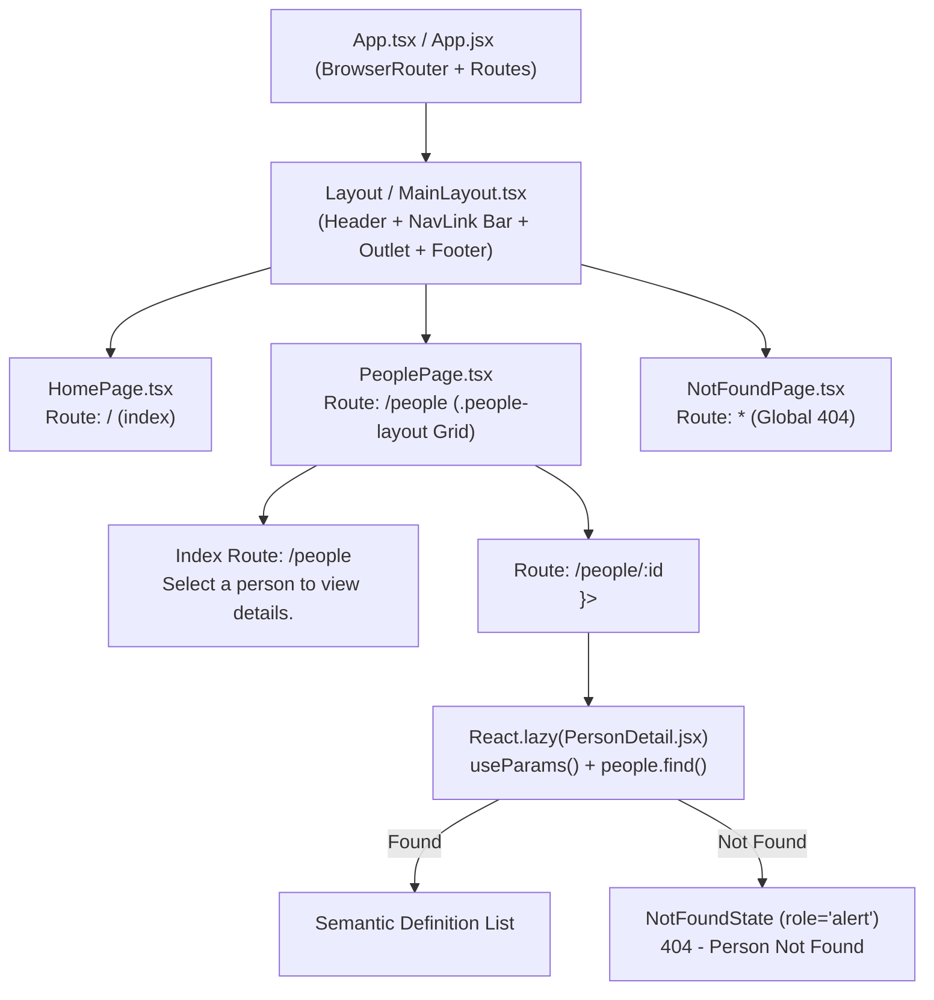

# Project Structure & Architecture — Exercise 1.2: React Router v7 Layout Architecture

## 1. Project Overview

This repository (`24520225_NguyenBaoChinh_Lab04_Exercise1.2`) implements **Exercise 1.2: React Router v7 Layout Architecture** for Lab 04 of Web Application Development (MSIS207 / UIT).

Exercise 1.2 builds directly upon **Exercise 1.1** (`React.lazy()` code splitting and `<Suspense fallback={<Skeleton aria-busy="true" aria-live="polite" />}>`) and upgrades the single-view application into a **multi-route Single-Page Application (SPA)** powered by **React Router v7** (`react-router: ^7.18.6`).

### Relationship Across the Lab 04 Exercise Series
- **Inherited from Exercise 1.1 (`24520225_NguyenBaoChinh_Lab04_Exercise1.1`)**: Preserves dynamic code splitting for `PersonDetail` (`React.lazy(() => import('./PersonDetail.jsx'))`) and the accessible WAI-ARIA `Skeleton` fallback component (`src/Skeleton.tsx`, `src/Skeleton.jsx`, `src/Skeleton.css`).
- **Implemented in Exercise 1.2 (Current Repository)**:
  1. **Shared Nested Layout Architecture**: Persistent `<Layout />` (`MainLayout.tsx` / `MainLayout.jsx`) with active `<NavLink>` navigation (`Home` and `People`) and `<Outlet />`.
  2. **Master-Detail Directory (`/people` & `/people/:id`)**: Two-column responsive CSS Grid (`grid-template-columns: minmax(280px, 1fr) 2fr`) in `PeoplePage.tsx` where selecting a person from the `.people-master` list renders their detail view inside `.people-detail-panel`.
  3. **Safe URL Parameter Extraction & 404 Entity Fallback**: `PersonDetail` extracts `:id` via `useParams()`, queries the directory via `people.find((p) => p.id === id)`, and renders `<NotFoundState id={id} />` (`404 - Person Not Found`) for invalid IDs without crashing.
  4. **Semantic HTML Definition Lists**: Renders entity attributes using semantic `<dl className="person-details">`, `<dt>`, and `<dd>` elements.
- **Extended in Exercise 1.3 (`24520225_NguyenBaoChinh_Lab04_Exercise1.3`)**: Exercise 1.3 inherits this entire Exercise 1.2 router and master-detail layout and adds the `/validation` route for legacy `useEffect` anti-pattern auditing.

Companion Exercise 1.2 Governance Documents:
- [`AI_FAILURE_AUDIT.md`](file:///Users/chinh/UIT%20lecture/WebApplicationDevelopment/Lab/Lab04/Exercise/24520225_NguyenBaoChinh_Lab04_Exercise1.2/AI_FAILURE_AUDIT.md)
- [`TASK_DECOMPOSITION.md`](file:///Users/chinh/UIT%20lecture/WebApplicationDevelopment/Lab/Lab04/Exercise/24520225_NguyenBaoChinh_Lab04_Exercise1.2/TASK_DECOMPOSITION.md)
- [`project-rules.md`](file:///Users/chinh/UIT%20lecture/WebApplicationDevelopment/Lab/Lab04/Exercise/24520225_NguyenBaoChinh_Lab04_Exercise1.2/project-rules.md)

---

## 2. Technology Stack (Exercise 1.2)

Inspected directly from [`package.json`](file:///Users/chinh/UIT%20lecture/WebApplicationDevelopment/Lab/Lab04/Exercise/24520225_NguyenBaoChinh_Lab04_Exercise1.2/package.json):

| Category | Package | Version | Role in Exercise 1.2 |
| :--- | :--- | :--- | :--- |
| **UI Runtime** | `react`, `react-dom` | `^19.3.1` | Functional components, `React.lazy()`, `<Suspense>` boundary |
| **Routing Framework** | `react-router` | `^7.18.6` | `BrowserRouter`, `Routes`, `Route`, `NavLink`, `Outlet`, `Link`, `useParams` |
| **Language & Compiler** | `typescript` | `~6.0.3` | Static type checking (`tsc -b`), `Person` & `PersonDetailProps` interfaces, `.tsx`/`.jsx` interoperability (`allowJs: true`) |
| **Bundler & Dev Server** | `vite`, `@vitejs/plugin-react` | `^8.3.6`, `^6.1.2` | SPA dev server, Rollup code splitting for `PersonDetail` lazy chunk |
| **Static Linter** | `eslint`, `eslint-plugin-react-hooks`, `typescript-eslint` | `^10.14.0`, `^7.1.1`, `^8.72.1` | Static analysis (`npm run lint`) |

---

## 3. Actual Directory Tree (`24520225_NguyenBaoChinh_Lab04_Exercise1.2`)

Generated from the actual files present in `24520225_NguyenBaoChinh_Lab04_Exercise1.2/`:

```text
24520225_NguyenBaoChinh_Lab04_Exercise1.2/
├── AI_FAILURE_AUDIT.md                  # Exercise 1.2 technical audit, failure modes & verification matrix
├── PROJECT_STRUCTURE.md                 # Exercise 1.2 routing architecture, directory tree & data flow
├── README.md                            # Project overview and setup instructions
├── TASK_DECOMPOSITION.md                # Exercise 1.2 4-Stage Contract-First milestone roadmap
├── project-rules.md                     # Exercise 1.2 mandatory development governance & Git safety rules
├── eslint.config.js                     # ESLint v10 flat configuration
├── index.html                           # HTML entry document mounting #root and loading /src/main.tsx
├── package-lock.json                    # Deterministic npm dependency lockfile
├── package.json                         # Dependencies (react, react-dom, react-router ^7.18.6) and scripts
├── tsconfig.json                        # Root TypeScript solution configuration
├── tsconfig.app.json                    # App TypeScript compiler config (ES2023, bundler, allowJs: true)
├── tsconfig.node.json                   # Node/Vite TypeScript configuration
├── vite.config.ts                       # Vite bundler configuration
├── public/
│   ├── favicon.svg                      # Application favicon
│   └── icons.svg                        # Shared SVG icon sprite
└── src/
    ├── main.tsx                         # Primary TypeScript entry point mounting <App /> inside <StrictMode>
    ├── main.jsx                         # Interoperable JSX entry point mounting <App />
    ├── index.css                        # Global CSS reset, typography, and root container baseline
    ├── App.tsx                          # Declarative React Router v7 <BrowserRouter> & nested <Routes> (TSX)
    ├── App.jsx                          # Declarative React Router v7 <BrowserRouter> & nested <Routes> (JSX)
    ├── App.css                          # Header, active NavLink, .people-layout CSS Grid (minmax(280px, 1fr) 2fr)
    ├── PersonDetail.tsx                 # TypeScript PersonDetail wrapper, PersonDetailContent, and NotFoundState
    ├── PersonDetail.jsx                 # Lazy-loaded PersonDetail component using useParams(), people.find(), <dl>
    ├── PersonDetail.css                 # Styles for <dl className="person-details"> and 404 .not-found-state card
    ├── Skeleton.tsx                     # Accessible WAI-ARIA loading skeleton fallback inherited from Ex 1.1 (TSX)
    ├── Skeleton.jsx                     # Accessible WAI-ARIA loading skeleton fallback inherited from Ex 1.1 (JSX)
    ├── Skeleton.css                     # Shimmer keyframe animation and skeleton card layout styles
    ├── assets/
    │   ├── hero.png                     # Template hero graphic
    │   ├── react.svg                    # React logo
    │   └── vite.svg                     # Vite logo
    ├── data/
    │   ├── people.ts                    # Typed Person interface and 4-record directory dataset (TypeScript)
    │   └── people.js                    # Interoperable 4-record directory dataset (JavaScript)
    ├── layouts/
    │   ├── MainLayout.tsx               # Shared layout header, Home/People NavLinks, <Outlet />, footer (TSX)
    │   └── MainLayout.jsx               # Shared layout header, Home/People NavLinks, <Outlet />, footer (JSX)
    └── pages/
        ├── HomePage.tsx                 # Home route (/) landing view (TSX)
        ├── HomePage.jsx                 # Home route (/) landing view (JSX)
        ├── PeoplePage.tsx               # Master-detail route (/people) with sidebar NavLinks & child <Outlet /> (TSX)
        ├── PeoplePage.jsx               # Master-detail route (/people) with sidebar NavLinks & child <Outlet /> (JSX)
        ├── NotFoundPage.tsx             # Global wildcard 404 route (*) with link back to Home (TSX)
        └── NotFoundPage.jsx             # Global wildcard 404 route (*) with link back to Home (JSX)
```

---

## 4. Exercise 1.2 Specific Architecture

### 4.1. Declarative Routing & Shared Layout (`App.tsx` & `MainLayout.tsx`)
In [`src/App.tsx`](file:///Users/chinh/UIT%20lecture/WebApplicationDevelopment/Lab/Lab04/Exercise/24520225_NguyenBaoChinh_Lab04_Exercise1.2/src/App.tsx) (and [`src/layouts/MainLayout.tsx`](file:///Users/chinh/UIT%20lecture/WebApplicationDevelopment/Lab/Lab04/Exercise/24520225_NguyenBaoChinh_Lab04_Exercise1.2/src/layouts/MainLayout.tsx)), the application replaces legacy v5 `<Switch>` paradigms with React Router v7 `<Routes>` and nested `<Route element={<Layout />}>`:
- **Active `<NavLink>` Styling**:
  ```tsx
  <NavLink
    to="/"
    end
    className={({ isActive }) => (isActive ? 'nav-link active' : 'nav-link')}
  >
    Home
  </NavLink>
  <NavLink
    to="/people"
    className={({ isActive }) => (isActive ? 'nav-link active' : 'nav-link')}
  >
    People
  </NavLink>
  ```
- The `end` prop on `<NavLink to="/" end>` ensures `Home` is not highlighted as active when navigating to `/people` or `/people/:id`.

### 4.2. Master-Detail Directory & Responsive CSS Grid (`PeoplePage.tsx` & `App.css`)
In [`src/pages/PeoplePage.tsx`](file:///Users/chinh/UIT%20lecture/WebApplicationDevelopment/Lab/Lab04/Exercise/24520225_NguyenBaoChinh_Lab04_Exercise1.2/src/pages/PeoplePage.tsx), the directory view is structured as a two-pane master-detail interface (without any extraneous search input, strictly adhering to selecting a person from the People list):
- **Left Pane (`<aside className="people-master">`)**: Maps over `people` from [`src/data/people.ts`](file:///Users/chinh/UIT%20lecture/WebApplicationDevelopment/Lab/Lab04/Exercise/24520225_NguyenBaoChinh_Lab04_Exercise1.2/src/data/people.ts) and renders `<NavLink to={`/people/${person.id}`}>` with active state class `.person-link.active`.
- **Right Pane (`<section className="people-detail-panel">`)**: Renders a nested `<Outlet />` that displays `<p>Select a person to view details.</p>` on `/people` (index route) or the lazy-loaded `<PersonDetail people={people} />` on `/people/:id`.
- **Responsive CSS Grid ([`src/App.css`](file:///Users/chinh/UIT%20lecture/WebApplicationDevelopment/Lab/Lab04/Exercise/24520225_NguyenBaoChinh_Lab04_Exercise1.2/src/App.css#L119-L130))**:
  ```css
  .people-layout {
    display: grid;
    grid-template-columns: minmax(280px, 1fr) 2fr;
    gap: 24px;
    align-items: start;
  }

  @media (max-width: 768px) {
    .people-layout {
      grid-template-columns: 1fr;
    }
  }
  ```

### 4.3. Safe URL Parameter Extraction, 404 Entity Fallback & Semantic `<dl>` (`PersonDetail.jsx` / `PersonDetail.tsx`)
In [`src/PersonDetail.jsx`](file:///Users/chinh/UIT%20lecture/WebApplicationDevelopment/Lab/Lab04/Exercise/24520225_NguyenBaoChinh_Lab04_Exercise1.2/src/PersonDetail.jsx) and [`src/PersonDetail.tsx`](file:///Users/chinh/UIT%20lecture/WebApplicationDevelopment/Lab/Lab04/Exercise/24520225_NguyenBaoChinh_Lab04_Exercise1.2/src/PersonDetail.tsx):
1. **Dynamic Route Parameter Extraction**: Calls `const { id } = useParams();` to read `:id` from `/people/:id`.
2. **Safe Entity Lookup**: Calls `const person = people.find((p) => p.id === id);`.
3. **Graceful 404 Entity Fallback (`NotFoundState`)**: If `!person` (e.g., `/people/999` or `/people/unknown`), returns `<NotFoundState id={id} />`, rendering an accessible alert card (`role="alert"`) with badge `404`, heading `404 - Person Not Found`, message `The requested person (ID: "999") could not be found in the directory.`, and `<Link to="/people" className="back-to-people-btn">← Return to People Directory</Link>`.
4. **Semantic HTML Definition List (`<dl>`, `<dt>`, `<dd>`)**: When a valid person is found, renders:
   ```tsx
   <dl className="person-details">
     <dt>Name:</dt>
     <dd>{person.name}</dd>
     <dt>Role:</dt>
     <dd>{person.role}</dd>
     <dt>Department:</dt>
     <dd>{person.department}</dd>
     <dt>Status:</dt>
     <dd>{person.status}</dd>
   </dl>
   ```

---

## 5. Component Hierarchy & Responsibilities



---

## 6. Routing & Data Flow Architecture

| URL Pattern | Matched Route Hierarchy | Rendered Components in `<Outlet />` | Data Flow & Parameter Handling |
| :--- | :--- | :--- | :--- |
| `/` | `<Route path="/" element={<Layout />}>` → `<Route index>` | `HomePage` | Static welcome content |
| `/people` | `<Route path="/">` → `<Route path="people">` → `<Route index>` | `PeoplePage` + `<p>Select a person to view details.</p>` | `PeoplePage` maps `people` array (`id: '1'..'4'`) into sidebar `<NavLink>` items |
| `/people/2` | `<Route path="/">` → `<Route path="people">` → `<Route path=":id">` | `PeoplePage` + `<Suspense>` → `PersonDetail` (`<dl>`) | `useParams()` extracts `id = "2"`; `people.find(p => p.id === "2")` returns `Nguyen Bao Chinh` |
| `/people/999` | `<Route path="/">` → `<Route path="people">` → `<Route path=":id">` | `PeoplePage` + `<Suspense>` → `NotFoundState` | `useParams()` extracts `id = "999"`; `people.find()` returns `undefined` → renders `404 - Person Not Found` |
| `/unknown-url` | `<Route path="/">` → `<Route path="*">` | `NotFoundPage` | Global catch-all route renders `404 - Page Not Found` with `<Link to="/">` |
