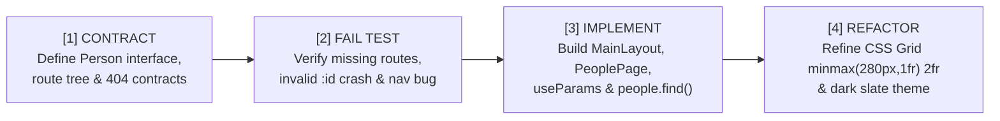

# Task Decomposition & Contract-First Roadmap — Exercise 1.2: React Router v7 Layout Architecture

## 1. Mandatory Development Workflow: Strict 4-Stage Contract-First Loop

All routing, layout, and master-detail features in **Exercise 1.2** (`24520225_NguyenBaoChinh_Lab04_Exercise1.2`) follow the **Strict 4-Stage Contract-First Loop** mandated by [`project-rules.md`](file:///Users/chinh/UIT%20lecture/WebApplicationDevelopment/Lab/Lab04/Exercise/24520225_NguyenBaoChinh_Lab04_Exercise1.2/project-rules.md):

### Stage Definitions for Exercise 1.2
- **`[1] CONTRACT`**:
  - Define `Person` interface (`id: string`, `name: string`, `role: string`, `department: string`, `status: string`) in `src/data/people.ts` and `PersonDetailProps` (`people?: Person[]`) in `src/PersonDetail.tsx`.
  - Define the nested route contract under `<BrowserRouter>` and `<Routes>`: `/` (`HomePage`), `/people` (`PeoplePage` with index prompt), `/people/:id` (lazy `PersonDetail` inside `<Suspense fallback={<Skeleton />}>`), and `*` (`NotFoundPage`).
  - Define the `PersonDetail` lookup and markup contract: extract `id` via `useParams()`, query `people.find((p) => p.id === id)`, render `<NotFoundState id={id} />` when `!person`, and render semantic `<dl className="person-details">` (`<dt>`/`<dd>`) when found.
  - Define the responsive master-detail CSS Grid contract: `.people-layout { display: grid; grid-template-columns: minmax(280px, 1fr) 2fr; gap: 24px; }`, collapsing to `1fr` at `@media (max-width: 768px)`.
- **`[2] FAIL TEST`**:
  - Verify that navigating to `/people/999` without `NotFoundState` fails to display a user-friendly 404 entity alert and that omitting `end` on `<NavLink to="/">` leaves `Home` highlighted on `/people`.
- **`[3] IMPLEMENT`**:
  - Implement `MainLayout`, `HomePage`, `PeoplePage`, `NotFoundPage`, `people.ts`/`people.js`, and `PersonDetail` with `useParams()`, `people.find()`, `<NotFoundState />`, and `<dl>/<dt>/<dd>`.
- **`[4] REFACTOR`**:
  - Harmonize `.tsx` and `.jsx` modules with `"allowJs": true` in `tsconfig.app.json`, polish active navigation gradients, and verify `npm run lint` and `npm run build`.

Companion Exercise 1.2 Documents:
- [`PROJECT_STRUCTURE.md`](file:///Users/chinh/UIT%20lecture/WebApplicationDevelopment/Lab/Lab04/Exercise/24520225_NguyenBaoChinh_Lab04_Exercise1.2/PROJECT_STRUCTURE.md)
- [`AI_FAILURE_AUDIT.md`](file:///Users/chinh/UIT%20lecture/WebApplicationDevelopment/Lab/Lab04/Exercise/24520225_NguyenBaoChinh_Lab04_Exercise1.2/AI_FAILURE_AUDIT.md)
- [`project-rules.md`](file:///Users/chinh/UIT%20lecture/WebApplicationDevelopment/Lab/Lab04/Exercise/24520225_NguyenBaoChinh_Lab04_Exercise1.2/project-rules.md)

---

## 2. Exercise 1.2 Milestone & Task Breakdown

### Milestone M0 — Inherit Exercise 1.1 Baseline & Install React Router v7

| Task ID | Description | Prerequisites | Deliverables | Acceptance Criteria | Status |
| :--- | :--- | :--- | :--- | :--- | :---: |
| **EX1.2-M0.1** | Inherit Exercise 1.1 baseline (`PersonDetail`, `Skeleton`, `React.lazy`, `<Suspense>`). | None | `src/Skeleton.tsx`, `src/Skeleton.css`, `src/PersonDetail.tsx`, `src/PersonDetail.css` | All 6 original Exercise 1.1 commits (`5d5f740..415c355`) preserved intact in Git history. | `[x]` |
| **EX1.2-M0.2** | Install `react-router` v7 (`^7.18.6`) without unnecessary third-party packages. | EX1.2-M0.1 | `package.json`, `package-lock.json` | `react-router` added to `dependencies`; `npm run build` succeeds (`commit 7697644`). | `[x]` |

---

### Milestone M1 — Declarative Routing & Shared Nested Layout Architecture

| Task ID | Description | Prerequisites | Deliverables | Acceptance Criteria | Status |
| :--- | :--- | :--- | :--- | :--- | :---: |
| **EX1.2-M1.1** | Create `HomePage`, `PeoplePage`, and `NotFoundPage` route views and configure `<BrowserRouter>` + `<Routes>`. | EX1.2-M0.2 | `src/App.tsx`, `src/pages/HomePage.tsx`, `src/pages/PeoplePage.tsx`, `src/pages/NotFoundPage.tsx` | Routes `/`, `/people`, and `*` render declaratively (`commit 1c0e024`). | `[x]` |
| **EX1.2-M1.2** | Implement `MainLayout` with shared header, `<NavLink>` navigation (`Home` with `end`, `People`), `<Outlet />`, and footer. | EX1.2-M1.1 | `src/layouts/MainLayout.tsx`, `src/layouts/MainLayout.jsx` | Child routes render inside `<main className="content-section"><Outlet /></main>` (`commit 117b7ce`). | `[x]` |
| **EX1.2-M1.3** | Implement active navigation styling (`.nav-link` and `.nav-link.active`). | EX1.2-M1.2 | `src/App.css` | Active `<NavLink>` applies `.nav-link.active` styling automatically (`commit da2d5e2`). | `[x]` |

---

### Milestone M2 — Master-Detail Directory, `useParams()`, `people.find()` & Semantic `<dl>`

| Task ID | Description | Prerequisites | Deliverables | Acceptance Criteria | Status |
| :--- | :--- | :--- | :--- | :--- | :---: |
| **EX1.2-M2.1** | Create typed `Person` dataset (`id: '1'..'4'`) in `src/data/people.ts` and `src/data/people.js`. | EX1.2-M1.3 | `src/data/people.ts`, `src/data/people.js` | Exports `Person` interface and 4 records (`John Doe`, `Nguyen Bao Chinh`, `Tran Trong Khiem`, `Emily Tran`) (`commits 894b83f, b458b6a`). | `[x]` |
| **EX1.2-M2.2** | Implement 2-column master-detail layout in `PeoplePage` (`grid-template-columns: minmax(280px, 1fr) 2fr`) with sidebar `<NavLink>` items and nested `<Outlet />`. | EX1.2-M2.1 | `src/pages/PeoplePage.tsx`, `src/pages/PeoplePage.jsx`, `src/App.css` | Desktop layout uses `minmax(280px, 1fr) 2fr`; mobile `<= 768px` collapses to `1fr` (`commit 894b83f`). | `[x]` |
| **EX1.2-M2.3** | Implement dynamic parameter extraction (`useParams()`), entity lookup (`people.find()`), and semantic definition list (`<dl>`, `<dt>`, `<dd>`) in `PersonDetail`. | EX1.2-M2.2 | `src/PersonDetail.tsx`, `src/PersonDetail.jsx`, `src/PersonDetail.css` | Selecting `/people/2` renders `<dl className="person-details">` for `Nguyen Bao Chinh` wrapped in `<Suspense fallback={<Skeleton />}>` (`commits 894b83f, 92043a9`). | `[x]` |

---

### Milestone M3 — Robust 404 Entity Fallback (`NotFoundState`) & Governance Documentation

| Task ID | Description | Prerequisites | Deliverables | Acceptance Criteria | Status |
| :--- | :--- | :--- | :--- | :--- | :---: |
| **EX1.2-M3.1** | Implement `NotFoundState` fallback component when `people.find((p) => p.id === id)` returns `undefined`. | EX1.2-M2.3 | `src/PersonDetail.tsx`, `src/PersonDetail.jsx`, `src/PersonDetail.css` | Navigating to `/people/999` renders `404 - Person Not Found` (`role="alert"`) with the invalid ID and `<Link to="/people">` recovery button (`commits 59c5d28, 0f495e3, 4296604`). | `[x]` |
| **EX1.2-M3.2** | Author Exercise 1.2 documentation governance set (`PROJECT_STRUCTURE.md`, `TASK_DECOMPOSITION.md`, `AI_FAILURE_AUDIT.md`, `project-rules.md`). | EX1.2-M3.1 | `PROJECT_STRUCTURE.md`, `TASK_DECOMPOSITION.md`, `AI_FAILURE_AUDIT.md`, `project-rules.md` | All 4 Markdown files exist in `24520225_NguyenBaoChinh_Lab04_Exercise1.2/` and pass verification checks. | `[x]` |
