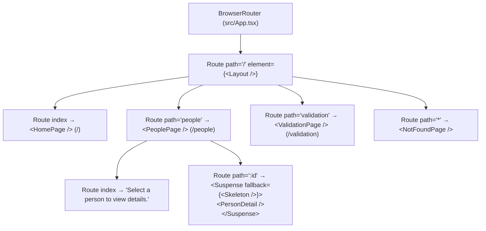
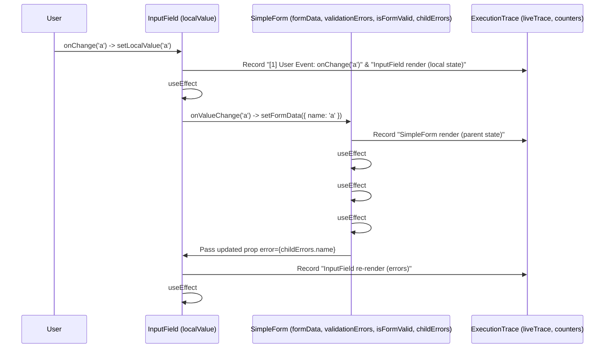

# Project Structure & Architecture — Lab 04 (Exercises 1.1, 1.2, and 1.3)

## 1. Project Overview

This repository (`24520225_NguyenBaoChinh_Lab04_Exercise1.3`) contains the continuous, incremental implementation of **Lab 04: Multi-Route SPA Architecture & React Anti-Pattern Auditing** for Web Application Development (MSIS207 / UIT).

Rather than creating three disconnected standalone applications, this project follows a strict inheritance chain (**Exercise 1.1 → Exercise 1.2 → Exercise 1.3**) inside a unified React 19 + TypeScript 6 + Vite 8 + React Router v7 single-page application (SPA):

1. **Exercise 1.1 — Performance & Resiliency Architectural Upgrades**: Introduces asynchronous component code splitting via `React.lazy()` and resilient loading fallback boundaries via `<Suspense>` with an accessible WAI-ARIA `Skeleton` component (`aria-busy="true"`, `aria-live="polite"`).
2. **Exercise 1.2 — React Router v7 Layout Architecture**: Evolves the application into a declarative multi-route SPA with shared nested layouts (`<Outlet />`, active `<NavLink>`), master-detail directory views (`/people/:id`), safe URL parameter extraction (`useParams()`), resilient entity lookup (`people.find()`), non-crashing 404 entity fallback (`NotFoundState`), semantic HTML definition lists (`<dl>`, `<dt>`, `<dd>`), and a responsive CSS Grid master-detail layout (`grid-template-columns: minmax(280px, 1fr) 2fr`).
3. **Exercise 1.3 — Legacy Validation Anti-Patterns**: Integrates an interactive architectural diagnostic dashboard at `/validation` that deconstructs a 5-hook chained `useEffect` validation architecture across `InputField` and `SimpleForm`, measures actual vs. conceptual render/effect cascades, reproduces asynchronous validation race conditions (**MODE A: Legacy Async Validation** vs. **MODE B: Protected Validation**), and isolates the **Infinite Loop Risk** (`Maximum update depth exceeded`) as a safe non-executing code fixture.

Cross-references:
- For architectural flaw root-cause analysis and verification results, see [`AI_FAILURE_AUDIT.md`](file:///Users/chinh/UIT%20lecture/WebApplicationDevelopment/Lab/Lab04/Exercise/24520225_NguyenBaoChinh_Lab04_Exercise1.3/AI_FAILURE_AUDIT.md).
- For the 4-Stage Contract-First milestone roadmap (`G0`–`G4`), see [`TASK_DECOMPOSITION.md`](file:///Users/chinh/UIT%20lecture/WebApplicationDevelopment/Lab/Lab04/Exercise/24520225_NguyenBaoChinh_Lab04_Exercise1.3/TASK_DECOMPOSITION.md).
- For mandatory development and Git safety governance rules, see [`project-rules.md`](file:///Users/chinh/UIT%20lecture/WebApplicationDevelopment/Lab/Lab04/Exercise/24520225_NguyenBaoChinh_Lab04_Exercise1.3/project-rules.md).

---

## 2. Technology Stack

| Layer | Package / Tool | Version (from `package.json`) | Purpose |
| :--- | :--- | :--- | :--- |
| **UI Runtime** | `react`, `react-dom` | `^19.3.1` | Component rendering, Concurrent Suspense, Hooks (`useState`, `useEffect`, `useCallback`, `useRef`) |
| **Routing Engine** | `react-router` | `^7.18.6` | Declarative routing (`BrowserRouter`, `Routes`, `Route`, `NavLink`, `Outlet`, `Link`, `useParams`) |
| **Language & Type Checker** | `typescript` | `~6.0.3` | Static type checking (`tsc -b`), explicit prop/state interfaces, mixed `.tsx`/`.jsx` interoperability (`allowJs: true`) |
| **Build Tool & Dev Server** | `vite`, `@vitejs/plugin-react` | `^8.3.6`, `^6.1.2` | ES module bundling, Rollup code-splitting for `React.lazy`, HMR development server |
| **Static Analysis / Linter** | `eslint`, `eslint-plugin-react-hooks`, `typescript-eslint` | `^10.14.0`, `^7.1.1`, `^8.72.1` | Flat-config linting (`eslint.config.js`), React Hooks rules enforcement (`react-hooks/refs`, `react-hooks/set-state-in-effect`) |

---

## 3. Directory Tree

The directory tree below reflects the exact verified structure of this repository:

```text
24520225_NguyenBaoChinh_Lab04_Exercise1.3/
├── AI_FAILURE_AUDIT.md                  # Technical audit of AI failure modes & verification matrix (Ex 1.1–1.3)
├── PROJECT_STRUCTURE.md                 # Complete architecture, directory tree, data flow, and file catalog
├── README.md                            # Vite + React + TypeScript starter documentation
├── TASK_DECOMPOSITION.md                # 4-Stage Contract-First milestone roadmap (G0–G4)
├── project-rules.md                     # Mandatory development governance, verification gates & Git safety rules
├── docs/
│   └── exercise-1.3/
│       └── execution_trace.log          # Canonical 5-hook execution trace & observed telemetry analysis log
├── execution_trace.log                  # Root-level copy of the 5-hook execution trace log
├── eslint.config.js                     # ESLint v10 flat configuration with react-hooks & typescript-eslint
├── index.html                           # HTML5 entry document mounting #root and loading /src/main.tsx
├── package-lock.json                    # Deterministic npm dependency lockfile
├── package.json                         # Project manifest, scripts (dev, build, lint, preview), and dependencies
├── tsconfig.json                        # Root TypeScript solution configuration referencing app and node configs
├── tsconfig.app.json                    # Application TypeScript compiler config (ES2023, bundler, allowJs: true)
├── tsconfig.node.json                   # Node/Vite config TypeScript compiler settings
├── vite.config.ts                       # Vite bundler configuration with @vitejs/plugin-react
├── public/
│   ├── favicon.svg                      # Application favicon
│   └── icons.svg                        # Shared SVG icon sprite
└── src/
    ├── main.tsx                         # Primary TypeScript application entry point (StrictMode + createRoot)
    ├── main.jsx                         # Interoperable JSX entry point synced from Exercise 1.2
    ├── index.css                        # Global CSS variables, typography, and root container baseline
    ├── App.tsx                          # Primary root router tree integrating Exercises 1.1, 1.2, and 1.3
    ├── App.jsx                          # Interoperable JSX root router tree synced from Exercise 1.2
    ├── App.css                          # Unified stylesheet: Layout, NavLink, Master-Detail Grid & Ex 1.3 Dashboard
    ├── PersonDetail.tsx                 # TypeScript PersonDetail wrapper, PersonDetailContent, and NotFoundState
    ├── PersonDetail.jsx                 # Lazy-loaded PersonDetail module using useParams(), people.find(), and <dl>
    ├── PersonDetail.css                 # Styles for PersonDetail <dl>/<dt>/<dd> and 404 NotFoundState alert card
    ├── Skeleton.tsx                     # Accessible WAI-ARIA loading skeleton component (TypeScript)
    ├── Skeleton.jsx                     # Accessible WAI-ARIA loading skeleton component (JSX)
    ├── Skeleton.css                     # Shimmer keyframe animation and skeleton card layout styles
    ├── execution_trace.log              # Source-level copy of the 5-hook execution trace log
    ├── assets/
    │   ├── hero.png                     # Template hero illustration asset
    │   ├── react.svg                    # React logo asset
    │   └── vite.svg                     # Vite logo asset
    ├── components/
    │   ├── ArchitecturalFlaws.tsx       # Left panel component: 3 Critical Architectural Flaws (TypeScript)
    │   ├── ArchitecturalFlaws.jsx       # Left panel component: 3 Critical Architectural Flaws (JSX)
    │   ├── ExecutionTrace.tsx           # Right panel terminal component: execution_trace.log & live event stream (TSX)
    │   ├── ExecutionTrace.jsx           # Right panel terminal component: execution_trace.log & live event stream (JSX)
    │   ├── InputField.tsx               # Child input component implementing useEffect #1 and useEffect #5 (TSX)
    │   ├── InputField.jsx               # Child input component implementing useEffect #1 and useEffect #5 (JSX)
    │   ├── SimpleForm.tsx               # Parent form component implementing useEffect #2, #3, #4 + Flaw Demos (TSX)
    │   └── SimpleForm.jsx               # Parent form component implementing useEffect #2, #3, #4 + Flaw Demos (JSX)
    ├── data/
    │   ├── people.ts                    # Typed Person interface and 4-record directory dataset (TypeScript)
    │   └── people.js                    # Interoperable 4-record directory dataset (JavaScript)
    ├── layouts/
    │   ├── MainLayout.tsx               # Shared layout header, NavLink navigation bar, <Outlet />, and footer (TSX)
    │   └── MainLayout.jsx               # Shared layout header, NavLink navigation bar, <Outlet />, and footer (JSX)
    └── pages/
        ├── HomePage.tsx                 # Landing route (/) introducing declarative routing & shared layouts (TSX)
        ├── HomePage.jsx                 # Landing route (/) introducing declarative routing & shared layouts (JSX)
        ├── PeoplePage.tsx               # Master-detail route (/people) with sidebar NavLinks and child <Outlet /> (TSX)
        ├── PeoplePage.jsx               # Master-detail route (/people) with sidebar NavLinks and child <Outlet /> (JSX)
        ├── ValidationPage.tsx           # Exercise 1.3 route (/validation) hosting flaws, trace, and form demos (TSX)
        ├── ValidationPage.jsx           # Exercise 1.3 route (/validation) hosting flaws, trace, and form demos (JSX)
        ├── NotFoundPage.tsx             # Global wildcard 404 route (*) with link back to Home (TSX)
        └── NotFoundPage.jsx             # Global wildcard 404 route (*) with link back to Home (JSX)
```

---

## 4. Exercise 1.1 Architecture — Code Splitting & Accessible Suspense

Exercise 1.1 establishes non-blocking component loading and accessible loading feedback:

1. **Dynamic Chunk Splitting (`React.lazy`)**:
   - In [`src/App.tsx`](file:///Users/chinh/UIT%20lecture/WebApplicationDevelopment/Lab/Lab04/Exercise/24520225_NguyenBaoChinh_Lab04_Exercise1.3/src/App.tsx#L12-L15), `PersonDetail` is dynamically imported via:
     ```tsx
     const PersonDetail = React.lazy(() =>
       import('./PersonDetail.jsx')
     );
     ```
   - During `npm run build`, Vite splits `PersonDetail` and its styles into dedicated asynchronous chunks (`dist/assets/PersonDetail-osYEGf6f.js` and `dist/assets/PersonDetail-mlLM2bRR.css`).
2. **Resilient `<Suspense>` Boundary**:
   - The lazy `PersonDetail` element is wrapped in `<Suspense fallback={<Skeleton aria-busy="true" aria-live="polite" />}>`.
3. **Accessible WAI-ARIA `Skeleton` Component ([`src/Skeleton.tsx`](file:///Users/chinh/UIT%20lecture/WebApplicationDevelopment/Lab/Lab04/Exercise/24520225_NguyenBaoChinh_Lab04_Exercise1.3/src/Skeleton.tsx))**:
   - Renders a `<section className="skeleton-card">` with explicit assistive technology attributes: `aria-busy={ariaBusy}` (default `'true'`), `aria-live={ariaLive}` (default `'polite'`), and `aria-label="Loading person details"`.
   - Uses a CSS `.shimmer` keyframe animation (`background-size: 200% 100%`) in [`src/Skeleton.css`](file:///Users/chinh/UIT%20lecture/WebApplicationDevelopment/Lab/Lab04/Exercise/24520225_NguyenBaoChinh_Lab04_Exercise1.3/src/Skeleton.css) to mirror the avatar and key-value rows of a person profile without layout shift.

---

## 5. Exercise 1.2 Architecture — React Router v7 & Master-Detail Layout

Exercise 1.2 wraps the application in a declarative multi-route hierarchy using React Router v7:

1. **Shared Layout & Active Navigation ([`src/App.tsx`](file:///Users/chinh/UIT%20lecture/WebApplicationDevelopment/Lab/Lab04/Exercise/24520225_NguyenBaoChinh_Lab04_Exercise1.3/src/App.tsx#L19-L57) & [`src/layouts/MainLayout.tsx`](file:///Users/chinh/UIT%20lecture/WebApplicationDevelopment/Lab/Lab04/Exercise/24520225_NguyenBaoChinh_Lab04_Exercise1.3/src/layouts/MainLayout.tsx))**:
   - Top-level `<Route path="/" element={<Layout />}>` renders the persistent header, `<nav className="main-navigation">` with `<NavLink>` items (`Home`, `People`, `Exercise 1.3: Validation`), `<main className="content-section"><Outlet /></main>`, and `<footer className="app-footer">`.
   - Each `<NavLink>` computes `className={({ isActive }) => (isActive ? 'nav-link active' : 'nav-link')}` (with `end` on the root `/` link so it does not stay active on child routes).
2. **Master-Detail Directory ([`src/pages/PeoplePage.tsx`](file:///Users/chinh/UIT%20lecture/WebApplicationDevelopment/Lab/Lab04/Exercise/24520225_NguyenBaoChinh_Lab04_Exercise1.3/src/pages/PeoplePage.tsx))**:
   - Renders `<div className="people-layout">` styled with `display: grid; grid-template-columns: minmax(280px, 1fr) 2fr; gap: 24px;` (collapsing to `1fr` at `@media (max-width: 768px)`).
   - Left master panel (`<aside className="people-master">`) maps over `people` from [`src/data/people.ts`](file:///Users/chinh/UIT%20lecture/WebApplicationDevelopment/Lab/Lab04/Exercise/24520225_NguyenBaoChinh_Lab04_Exercise1.3/src/data/people.ts) (`id: '1'` John Doe, `id: '2'` Nguyen Bao Chinh, `id: '3'` Tran Trong Khiem, `id: '4'` Emily Tran).
   - Right detail panel (`<section className="people-detail-panel">`) renders a nested `<Outlet />` displaying either the index prompt (`<p>Select a person to view details.</p>`) or the lazy-loaded `<PersonDetail people={people} />` at `/people/:id`.
3. **Safe URL Parameter Extraction, 404 Fallback & Semantic `<dl>` ([`src/PersonDetail.jsx`](file:///Users/chinh/UIT%20lecture/WebApplicationDevelopment/Lab/Lab04/Exercise/24520225_NguyenBaoChinh_Lab04_Exercise1.3/src/PersonDetail.jsx) & [`src/PersonDetail.tsx`](file:///Users/chinh/UIT%20lecture/WebApplicationDevelopment/Lab/Lab04/Exercise/24520225_NguyenBaoChinh_Lab04_Exercise1.3/src/PersonDetail.tsx))**:
   - Extracts `const { id } = useParams();` and performs `const person = people.find((p) => p.id === id);`.
   - If `!person` (e.g., `/people/999`), renders `<NotFoundState id={id} />` with `role="alert"`, a `404 - Person Not Found` message displaying the invalid ID, and a recovery `<Link to="/people">` button.
   - When found, renders a semantic HTML definition list (`<dl className="person-details">`) with `<dt>` terms (`Name:`, `Role:`, `Department:`, `Status:`) and `<dd>` descriptions.

---

## 6. Exercise 1.3 Architecture — Legacy Validation Anti-Patterns

Exercise 1.3 is mounted at `/validation` ([`src/pages/ValidationPage.tsx`](file:///Users/chinh/UIT%20lecture/WebApplicationDevelopment/Lab/Lab04/Exercise/24520225_NguyenBaoChinh_Lab04_Exercise1.3/src/pages/ValidationPage.tsx)) and reproduces the dark navy (`#0b0f19`) developer dashboard specification:

1. **Two-Column Architectural Overview Grid (`.ex13-hero-grid`)**:
   - **Left Panel ([`src/components/ArchitecturalFlaws.tsx`](file:///Users/chinh/UIT%20lecture/WebApplicationDevelopment/Lab/Lab04/Exercise/24520225_NguyenBaoChinh_Lab04_Exercise1.3/src/components/ArchitecturalFlaws.tsx))**: Displays the red-bordered `CRITICAL ARCHITECTURAL FLAWS` card detailing **Cascading Re-renders**, **Race Conditions**, and **Infinite Loop Risk** (`Maximum update depth exceeded`).
   - **Right Panel ([`src/components/ExecutionTrace.tsx`](file:///Users/chinh/UIT%20lecture/WebApplicationDevelopment/Lab/Lab04/Exercise/24520225_NguyenBaoChinh_Lab04_Exercise1.3/src/components/ExecutionTrace.tsx))**: Displays the macOS-styled terminal window titled `execution_trace.log` with traffic-light dots, the 5-effect cascade tree (`trace-render-cycle --target Ex1.6`), the red `CASCADE DETECTED: 5 re-renders / 1 keypress` banner, measured render/effect counters (`inputFieldRenders`, `simpleFormRenders`, `effectPassCount`), a React 19 batching explanation note, and a live event stream (`liveTrace`).
2. **Interactive Functional Demonstrations ([`src/components/SimpleForm.tsx`](file:///Users/chinh/UIT%20lecture/WebApplicationDevelopment/Lab/Lab04/Exercise/24520225_NguyenBaoChinh_Lab04_Exercise1.3/src/components/SimpleForm.tsx) & [`src/components/InputField.tsx`](file:///Users/chinh/UIT%20lecture/WebApplicationDevelopment/Lab/Lab04/Exercise/24520225_NguyenBaoChinh_Lab04_Exercise1.3/src/components/InputField.tsx))**:
   - **Demo 1 — 5-Hook Chained Validation Form**: Executes `useEffect #1: syncToParent()`, `useEffect #2: validateField()`, `useEffect #3: calcFormValidity()`, `useEffect #4: syncErrorsToChild()`, and `useEffect #5: autoScrollToError()`.
   - **Demo 2 — Asynchronous Validation Race Condition Simulator**: Compares **MODE A: Legacy Async Validation** (no sequence ordering; slow `650ms` invalid response for `"a"` overwrites fast `140ms` valid response for `"abc"` with `STALE_OVERWROTE`) against **MODE B: Protected Validation** (tracks monotonically increasing `latestRaceSeqRef.current` and discards stale responses as `IGNORED_STALE`).
   - **Demo 3 — Infinite Loop Risk Fixture**: Displays the isolated non-executing `setFormState({ ...formState })` code pattern and safety banner (`"Demonstration only – intentionally unsafe code is not executed."`).

---

## 7. Component Responsibilities

| Component / Module | File Path | Primary Responsibilities | State & Hooks Used |
| :--- | :--- | :--- | :--- |
| `App` / `Layout` | `src/App.tsx`, `src/layouts/MainLayout.tsx` | Configures `<BrowserRouter>`, `<Routes>`, shared header, active `<NavLink>` bar, and top-level `<Outlet />`. | `React.lazy`, `<Suspense>` |
| `Skeleton` | `src/Skeleton.tsx` | Accessible loading placeholder during lazy chunk resolution. | Props: `aria-busy`, `aria-live` |
| `HomePage` | `src/pages/HomePage.tsx` | Renders the `/` welcome view. | Stateless |
| `PeoplePage` | `src/pages/PeoplePage.tsx` | Renders the 2-column master-detail `/people` directory and nested `<Outlet />`. | Stateless (reads `people`) |
| `PersonDetail` / `NotFoundState` | `src/PersonDetail.jsx`, `src/PersonDetail.tsx` | Extracts `:id` via `useParams()`, finds person via `people.find()`, renders `<dl>` or 404 `<NotFoundState />`. | `useParams()` |
| `NotFoundPage` | `src/pages/NotFoundPage.tsx` | Global wildcard (`*`) 404 route fallback. | Stateless |
| `ValidationPage` | `src/pages/ValidationPage.tsx` | Hosts Exercise 1.3 header, `ArchitecturalFlaws`, `ExecutionTrace`, and `SimpleForm`. | `useState` (`liveTrace`, `metrics`), `useCallback` |
| `ArchitecturalFlaws` | `src/components/ArchitecturalFlaws.tsx` | Renders the `CRITICAL ARCHITECTURAL FLAWS` specification card. | Stateless |
| `ExecutionTrace` | `src/components/ExecutionTrace.tsx` | Renders the `execution_trace.log` terminal window, measured counters, batching note, and live event stream. | Props from `ValidationPage` |
| `InputField` | `src/components/InputField.tsx` | Maintains duplicate child state `localValue`, runs `useEffect #1: syncToParent()` and `useEffect #5: autoScrollToError()`. | `useState` (`localValue`), `useRef` (`inputRef`), `useEffect` (#1, #5) |
| `SimpleForm` | `src/components/SimpleForm.tsx` | Maintains parent state (`formData`, `validationErrors`, `isFormValid`, `childErrors`), runs `useEffect #2, #3, #4`, and hosts Race Condition (Mode A/B) & Infinite Loop demos. | `useState`, `useRef`, `useCallback`, `useEffect` (#2, #3, #4) |

---

## 8. Data Flow & Routing Architecture

### 8.1. Declarative Route Hierarchy



### 8.2. Exercise 1.3 Parent-Child State Synchronization Flow



---

## 9. Validation Architecture (Exercise 1.3)

1. **Synchronous Field Validation Rules (`validateField(data: FormData)` in `SimpleForm.tsx`)**:
   - Empty or whitespace-only (`!data.name.trim()`): `errors.name = 'Name is required'`.
   - Length `< 3` (`data.name.trim().length < 3`): `errors.name = 'Name must contain at least 3 characters'`.
   - Length `>= 3`: `{}` (valid; `isFormValid` becomes `true`, enabling the Submit button).
2. **Equality Guards Against Unbounded Loops**:
   - `useEffect #2` checks `JSON.stringify(nextErrors) !== JSON.stringify(validationErrors)` before calling `setValidationErrors(nextErrors)`.
   - `useEffect #3` checks `nextValidity !== isFormValid` before calling `setIsFormValid(nextValidity)`.
   - `useEffect #4` checks `JSON.stringify(validationErrors) !== JSON.stringify(childErrors)` before calling `setChildErrors(validationErrors)`.
3. **Asynchronous Race Condition Architecture (`dispatchAsyncValidation` in `SimpleForm.tsx`)**:
   - Every async request increments `const seq = ++latestRaceSeqRef.current`.
   - Short invalid inputs (`< 3` chars) use `650ms`–`700ms` latency; valid inputs (`>= 3` chars) use `140ms`–`150ms` latency.
   - Upon timer completion, `const isStale = seq < latestRaceSeqRef.current` determines whether a newer request was already dispatched.
   - **MODE A (`LEGACY`)**: Ignores `isStale` and unconditionally overwrites `raceDisplayedResult`, flagging `STALE_OVERWROTE` when `isStale === true`.
   - **MODE B (`PROTECTED`)**: Checks `if (isStale)` and marks the entry `IGNORED_STALE` without mutating `raceDisplayedResult`.

---

## 10. Evidence, Telemetry Logs, and Configuration Files

- **Execution Trace Log Files**:
  - [`docs/exercise-1.3/execution_trace.log`](file:///Users/chinh/UIT%20lecture/WebApplicationDevelopment/Lab/Lab04/Exercise/24520225_NguyenBaoChinh_Lab04_Exercise1.3/docs/exercise-1.3/execution_trace.log): Canonical documentation artifact containing the 5-hook ASCII execution tree, observed telemetry logs for initial mount / `'a'` / `'abc'`, and architectural flaw analysis.
  - [`execution_trace.log`](file:///Users/chinh/UIT%20lecture/WebApplicationDevelopment/Lab/Lab04/Exercise/24520225_NguyenBaoChinh_Lab04_Exercise1.3/execution_trace.log) & [`src/execution_trace.log`](file:///Users/chinh/UIT%20lecture/WebApplicationDevelopment/Lab/Lab04/Exercise/24520225_NguyenBaoChinh_Lab04_Exercise1.3/src/execution_trace.log): Synchronized copies at the project root and `src/` directory.
- **Configuration Files**:
  - [`tsconfig.app.json`](file:///Users/chinh/UIT%20lecture/WebApplicationDevelopment/Lab/Lab04/Exercise/24520225_NguyenBaoChinh_Lab04_Exercise1.3/tsconfig.app.json): Configured with `"allowJs": true`, `"verbatimModuleSyntax": true`, `"strict": false`, `"noUnusedLocals": true`, `"noUnusedParameters": true` so both `.tsx` and `.jsx` modules compile cleanly under `tsc -b`.
  - [`eslint.config.js`](file:///Users/chinh/UIT%20lecture/WebApplicationDevelopment/Lab/Lab04/Exercise/24520225_NguyenBaoChinh_Lab04_Exercise1.3/eslint.config.js): Enforces `reactHooks.configs.flat.recommended` across `**/*.{ts,tsx}`. Intentional legacy anti-pattern `setState` calls inside `SimpleForm.tsx` `useEffect #2, #3, #4` are explicitly annotated with `// eslint-disable-next-line react-hooks/set-state-in-effect`.
