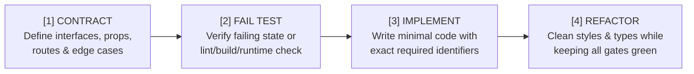

# Task Decomposition & Contract-First Roadmap — Lab 04 (Exercises 1.1, 1.2, and 1.3)

## 1. Mandatory Development Workflow: Strict 4-Stage Contract-First Loop

Every milestone and feature across **Exercise 1.1**, **Exercise 1.2**, and **Exercise 1.3** is governed by the **Strict 4-Stage Contract-First Loop** defined in [`project-rules.md`](file:///Users/chinh/UIT%20lecture/WebApplicationDevelopment/Lab/Lab04/Exercise/24520225_NguyenBaoChinh_Lab04_Exercise1.3/project-rules.md):

### Stage Definitions
- **`[1] CONTRACT`**: Define component TypeScript interfaces (`SkeletonProps`, `Person`, `PersonDetailProps`, `InputFieldProps`, `FormData`, `FormErrors`, `TraceLogEntry`, `RaceRequestEntry`), route patterns (`/`, `/people`, `/people/:id`, `/validation`, `*`), and edge cases (empty string, `< 3` characters, nonexistent person ID `/people/999`, out-of-order async responses, infinite effect loop risk).
- **`[2] FAIL TEST`**: Verify that the feature or test case fails prior to implementation (e.g., missing chunk split, missing 404 fallback on `/people/999`, `react-hooks/refs` or `react-hooks/set-state-in-effect` lint gate failure, or stale async response overwriting valid state in Mode A).
- **`[3] IMPLEMENT`**: Write the minimal functional React component implementation preserving all previous exercise routes and exact function identifiers (`syncToParent`, `validateField`, `calcFormValidity`, `syncErrorsToChild`, `autoScrollToError`).
- **`[4] REFACTOR`**: Consolidate responsive CSS Grid rules (`src/App.css`, `src/PersonDetail.css`, `src/Skeleton.css`), ensure zero horizontal overflow at `375px`, and verify `npm run lint` and `npm run build` pass with zero errors.

Cross-references:
- For architectural and file-level details, see [`PROJECT_STRUCTURE.md`](file:///Users/chinh/UIT%20lecture/WebApplicationDevelopment/Lab/Lab04/Exercise/24520225_NguyenBaoChinh_Lab04_Exercise1.3/PROJECT_STRUCTURE.md).
- For root-cause analysis of AI failure modes discovered during these stages, see [`AI_FAILURE_AUDIT.md`](file:///Users/chinh/UIT%20lecture/WebApplicationDevelopment/Lab/Lab04/Exercise/24520225_NguyenBaoChinh_Lab04_Exercise1.3/AI_FAILURE_AUDIT.md).
- For commit hygiene and verification gate rules, see [`project-rules.md`](file:///Users/chinh/UIT%20lecture/WebApplicationDevelopment/Lab/Lab04/Exercise/24520225_NguyenBaoChinh_Lab04_Exercise1.3/project-rules.md).

---

## 2. Milestone Breakdown (`G0` — `G4`)

### G0 — Repository Audit and Baseline

| Task ID | Description | Prerequisites | Deliverables | Acceptance Criteria | Status |
| :--- | :--- | :--- | :--- | :--- | :---: |
| **G0.1** | Inspect repository structure, `package.json`, TypeScript configs, and Git branch/commit history. | None | Verified baseline inventory of React `^19.3.1`, Vite `^8.3.6`, TypeScript `~6.0.3`, React Router `^7.18.6`. | `git status --short`, `git branch --show-current`, and `git log --oneline` inspected without destructive commands. | `[x]` |
| **G0.2** | Verify build and static analysis toolchain (`npm run lint` and `npm run build`). | G0.1 | Working Vite bundler (`vite.config.ts`) and ESLint flat config (`eslint.config.js`). | `tsc -b && vite build` and `eslint .` execute cleanly in the workspace. | `[x]` |

---

### G1 — Exercise 1.1: Code Splitting (`React.lazy`) & Accessible `<Suspense>` Fallback

- **`[1] CONTRACT`**:
  - `Skeleton` accepts `aria-busy?: boolean | 'true' | 'false'` (default `'true'`) and `aria-live?: 'off' | 'polite' | 'assertive'` (default `'polite'`), rendering `<section className="skeleton-card" aria-label="Loading person details">`.
  - `PersonDetail` is loaded asynchronously via `React.lazy(() => import('./PersonDetail.jsx'))` inside `<Suspense fallback={<Skeleton aria-busy="true" aria-live="polite" />}>`.
- **`[2] FAIL TEST`**:
  - Confirm static import bundles `PersonDetail` into the main entry chunk without a separate lazy asset or accessible loading state.
- **`[3] IMPLEMENT`**:
  - Implement `src/Skeleton.tsx`, `src/Skeleton.jsx`, `src/Skeleton.css`, `src/PersonDetail.tsx`, `src/PersonDetail.jsx`, `src/PersonDetail.css`, and lazy boundary in `src/App.tsx`.
- **`[4] REFACTOR`**:
  - Polish `.shimmer` keyframe animation and `@media (max-width: 600px)` responsive card rules.

| Task ID | Description | Prerequisites | Deliverables | Acceptance Criteria | Status |
| :--- | :--- | :--- | :--- | :--- | :---: |
| **G1.1** | Create `PersonDetail` component and profile card styling. | G0.2 | `src/PersonDetail.tsx`, `src/PersonDetail.jsx`, `src/PersonDetail.css` | Component renders person attributes cleanly (`commit 83ac242`). | `[x]` |
| **G1.2** | Implement accessible WAI-ARIA `Skeleton` fallback component with shimmer animation. | G1.1 | `src/Skeleton.tsx`, `src/Skeleton.jsx`, `src/Skeleton.css` | `<section className="skeleton-card" aria-busy="true" aria-live="polite" aria-label="Loading person details">` present (`commit 65897f9`). | `[x]` |
| **G1.3** | Implement `React.lazy()` dynamic import and `<Suspense>` wrapper around `PersonDetail`. | G1.1, G1.2 | `src/App.tsx`, `src/App.jsx` | Production build emits separate `dist/assets/PersonDetail-*.js` and `dist/assets/PersonDetail-*.css` chunks (`commit eab67b7`). | `[x]` |
| **G1.4** | Verify lazy loading chunk isolation and WAI-ARIA accessibility attributes. | G1.3 | `README.md`, build output verification | `npm run build` confirms code-split chunk and zero console errors (`commits 1dea1fa, 415c355`). | `[x]` |

---

### G2 — Exercise 1.2: React Router v7 Layout Architecture & Master-Detail Views

- **`[1] CONTRACT`**:
  - Route tree under `<BrowserRouter>` and `<Routes>`:
    - `/` (Shared `Layout` / `MainLayout` with active `<NavLink>` bar and `<Outlet />`)
    - `/` (`index` → `<HomePage />`)
    - `/people` (`<PeoplePage />` with 2-column CSS Grid `grid-template-columns: minmax(280px, 1fr) 2fr` and nested `<Outlet />`)
    - `/people/:id` (Lazy `<PersonDetail people={people} />` extracting `id` via `useParams()`, looking up record via `people.find(p => p.id === id)`, rendering semantic `<dl className="person-details">` or `<NotFoundState id={id} />`)
    - `*` (`<NotFoundPage />`)
- **`[2] FAIL TEST`**:
  - Navigating to `/people/999` without a null check or `NotFoundState` crashes or renders blank content; missing `end` prop on root `<NavLink to="/">` causes `Home` to stay active on `/people`.
- **`[3] IMPLEMENT`**:
  - Install `react-router` (`^7.18.6`), create `MainLayout`, `HomePage`, `PeoplePage`, `NotFoundPage`, `src/data/people.ts` (`people.js`), and update `PersonDetail` with `useParams()`, `people.find()`, `<NotFoundState />`, and `<dl>/<dt>/<dd>`.
- **`[4] REFACTOR`**:
  - Refine dark slate theme cards, active `.nav-link.active` and `.person-link.active` gradient badges, and `@media (max-width: 768px)` single-column responsive breakpoint.

| Task ID | Description | Prerequisites | Deliverables | Acceptance Criteria | Status |
| :--- | :--- | :--- | :--- | :--- | :---: |
| **G2.1** | Install `react-router` v7 and configure declarative `<BrowserRouter>` and `<Routes>`. | G1.4 | `package.json`, `src/App.tsx`, `src/pages/HomePage.tsx`, `src/pages/NotFoundPage.tsx` | Declarative routes `/`, `/people`, and `*` resolve without page reload (`commits 7697644, 1c0e024`). | `[x]` |
| **G2.2** | Implement nested layout architecture with `<Outlet />` and `<NavLink>` active states. | G2.1 | `src/layouts/MainLayout.tsx`, `src/layouts/MainLayout.jsx`, `src/App.css` | Shared header/footer persist across routes; active tab receives `.nav-link.active` (`commits 117b7ce, da2d5e2`). | `[x]` |
| **G2.3** | Implement master-detail `/people` and `/people/:id` views with `useParams()`, `people.find()`, and semantic `<dl>/<dt>/<dd>`. | G2.2 | `src/data/people.ts`, `src/data/people.js`, `src/pages/PeoplePage.tsx`, `src/PersonDetail.tsx`, `src/PersonDetail.jsx` | Clicking a person in `.people-master` renders their `<dl className="person-details">` in `.people-detail-panel`; CSS Grid uses `minmax(280px, 1fr) 2fr` (`commit 894b83f`). | `[x]` |
| **G2.4** | Implement robust 404 entity fallback (`NotFoundState`) for invalid `/people/:id` parameters and JSX/TSX interoperability. | G2.3 | `src/PersonDetail.tsx`, `src/PersonDetail.jsx`, `src/PersonDetail.css`, `tsconfig.app.json` | Navigating to `/people/999` renders `404 - Person Not Found (ID: "999")` with `role="alert"` and a recovery link to `/people` (`commits 59c5d28, 89dfa8d..4296604`). | `[x]` |

---

### G3 — Exercise 1.3: Legacy Validation Anti-Patterns & 5-Hook Chained Architecture

- **`[1] CONTRACT`**:
  - Components: `InputField.tsx`, `SimpleForm.tsx`, `ArchitecturalFlaws.tsx`, `ExecutionTrace.tsx`, integrated at route `/validation` (`ValidationPage.tsx`).
  - Five explicit `useEffect` hooks:
    1. `useEffect #1: syncToParent()` in `InputField.tsx`
    2. `useEffect #2: validateField()` in `SimpleForm.tsx`
    3. `useEffect #3: calcFormValidity()` in `SimpleForm.tsx`
    4. `useEffect #4: syncErrorsToChild()` in `SimpleForm.tsx`
    5. `useEffect #5: autoScrollToError()` in `InputField.tsx`
  - Three functional flaw demonstrations:
    - **Flaw A**: Cascading Re-renders interactive form with separate observed `InputField` and `SimpleForm` render counters and live event trace.
    - **Flaw B**: Asynchronous Race Condition demo with **MODE A: Legacy Async Validation** (`STALE_OVERWROTE`) and **MODE B: Protected Validation** (`IGNORED_STALE` via `latestRaceSeqRef.current`).
    - **Flaw C**: Isolated non-executing Infinite Loop Risk code demonstration (`setFormState({ ...formState })`) with safety banner `"Demonstration only – intentionally unsafe code is not executed."`.
  - Actual log file: `docs/exercise-1.3/execution_trace.log` (and root/`src/` copies).
- **`[2] FAIL TEST`**:
  - Accessing/mutating `renderCountRef.current += 1` during render fails ESLint `react-hooks/refs`; unannotated `setState` inside `useEffect` fails `react-hooks/set-state-in-effect`; `.gitignore` `*.log` rule blocks `git add execution_trace.log` without `-f`.
- **`[3] IMPLEMENT`**:
  - Implement `InputField.tsx`, `SimpleForm.tsx`, `ArchitecturalFlaws.tsx`, `ExecutionTrace.tsx`, `ValidationPage.tsx`, and `docs/exercise-1.3/execution_trace.log`.
- **`[4] REFACTOR`**:
  - Style the two-column dark developer dashboard (`#0b0f19`) in `src/App.css`, verify responsive single-column stacking at `375px` without horizontal overflow, and pass `npm run lint` + `npm run build`.

| Task ID | Description | Prerequisites | Deliverables | Acceptance Criteria | Status |
| :--- | :--- | :--- | :--- | :--- | :---: |
| **G3.1** | Implement `InputField` with local state duplication, `useEffect #1: syncToParent()`, and `useEffect #5: autoScrollToError()`. | G2.4 | `src/components/InputField.tsx`, `src/components/InputField.jsx` | Logs `useEffect #1: syncToParent()` and `useEffect #5: autoScrollToError()`; scrolls input into view on error (`commit c1b39cf`). | `[x]` |
| **G3.2** | Implement `SimpleForm` with `useEffect #2: validateField()`, `useEffect #3: calcFormValidity()`, and `useEffect #4: syncErrorsToChild()`. | G3.1 | `src/components/SimpleForm.tsx`, `src/components/SimpleForm.jsx` | Validates empty (`"Name is required"`), `< 3` chars (`"Name must contain at least 3 characters"`), and `>= 3` chars (Valid); passes `eslint .` (`commit ea488aa`). | `[x]` |
| **G3.3** | Create `ArchitecturalFlaws` and `ExecutionTrace` terminal component (`execution_trace.log` UI) with measured render/effect counters. | G3.2 | `src/components/ArchitecturalFlaws.tsx`, `src/components/ExecutionTrace.tsx` | Displays 3 flaws, macOS terminal dots, `execution_trace.log` header, 5-hook cascade tree, `CASCADE DETECTED`, and live event stream (`commits 0086519, 86e6d0f`). | `[x]` |
| **G3.4** | Implement interactive Race Condition demonstration (**MODE A: Legacy** vs. **MODE B: Protected**) and isolated **Infinite Loop Risk** code fixture. | G3.2, G3.3 | `src/components/SimpleForm.tsx` | Mode A reproduces `STALE_OVERWROTE` when `"a"` (650ms) resolves after `"abc"` (140ms); Mode B discards stale responses as `IGNORED_STALE`; Infinite Loop section displays safety warning (`commits ca45c54, c95e427`). | `[x]` |
| **G3.5** | Create actual `docs/exercise-1.3/execution_trace.log` file and integrate `/validation` route into React Router v7 layout. | G3.3, G3.4 | `docs/exercise-1.3/execution_trace.log`, `execution_trace.log`, `src/pages/ValidationPage.tsx`, `src/App.tsx`, `src/layouts/MainLayout.tsx`, `src/App.css` | `/validation` route accessible from top navigation bar; `execution_trace.log` committed to Git (`commits f217aa5, 24b5dee, 0ef7ca2, f1b8af6, b8b82ad`). | `[x]` |

---

### G4 — Final Integration, Automated Verification, and Governance Documentation

| Task ID | Description | Prerequisites | Deliverables | Acceptance Criteria | Status |
| :--- | :--- | :--- | :--- | :--- | :---: |
| **G4.1** | Execute automated end-to-end verification across Exercise 1.1, 1.2, and 1.3 (TC01–TC07, Race Mode A/B, 375px responsive check, `npm run lint`, `npm run build`). | G3.5 | Zero lint errors, zero TypeScript errors, verified runtime test logs | All routes (`/`, `/people/2`, `/people/999`, `/validation`) and TC01–TC07 verified in headless Chrome; `375px` horizontal overflow is `false`. | `[x]` |
| **G4.2** | Author `PROJECT_STRUCTURE.md` documenting the real directory tree, architecture, data flow, routing, and validation engines. | G4.1 | `PROJECT_STRUCTURE.md` | Matches actual workspace files and component contracts 100%. | `[x]` |
| **G4.3** | Author `TASK_DECOMPOSITION.md` with the 4-Stage Contract-First Loop and `G0`–`G4` milestone matrix. | G4.2 | `TASK_DECOMPOSITION.md` | Every task includes Prerequisites, Deliverables, Acceptance Criteria, and verified Status. | `[x]` |
| **G4.4** | Author `AI_FAILURE_AUDIT.md` auditing Exercises 1.1–1.3, AI failure categories, and verification matrix. | G4.3 | `AI_FAILURE_AUDIT.md` | Documents all real AI failure modes encountered and verified test results. | `[x]` |
| **G4.5** | Author `project-rules.md` establishing mandatory development governance, verification gates, and Git safety protocols. | G4.4 | `project-rules.md` | Enforces 4-stage loop, atomic commits, verification gates, and non-destructive Git rules. | `[x]` |
